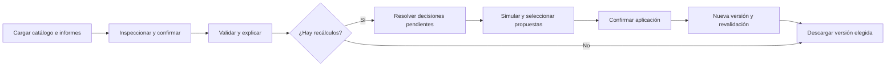
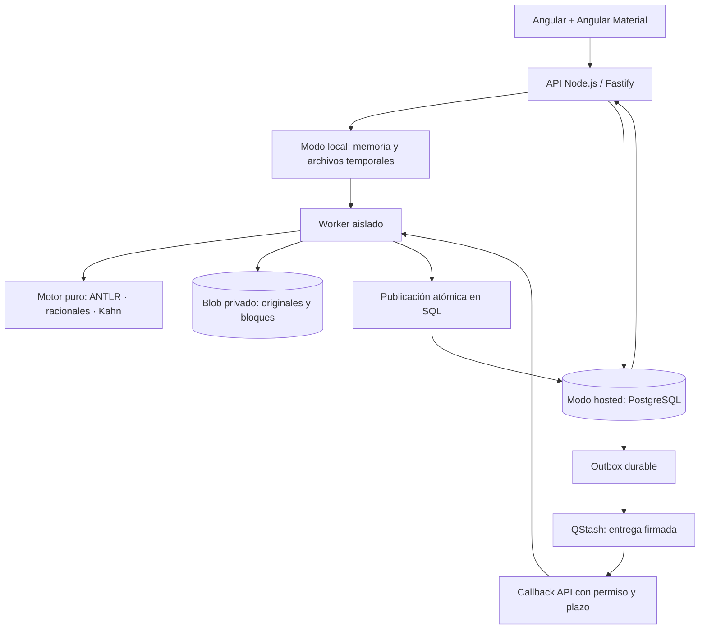
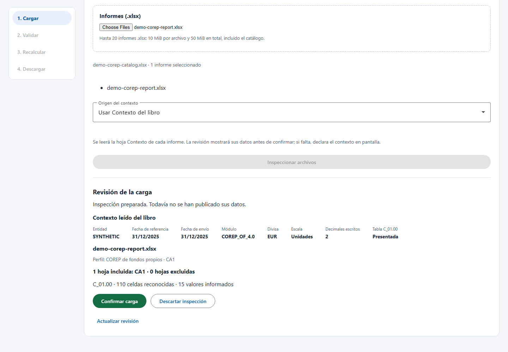
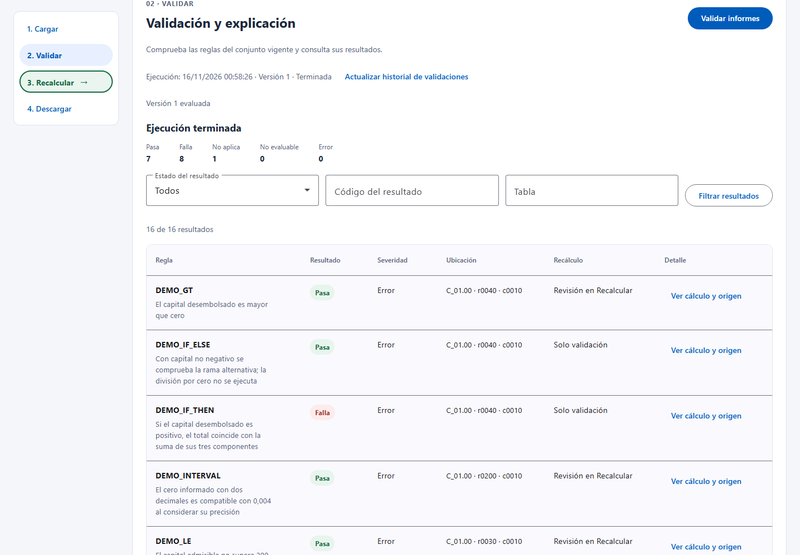
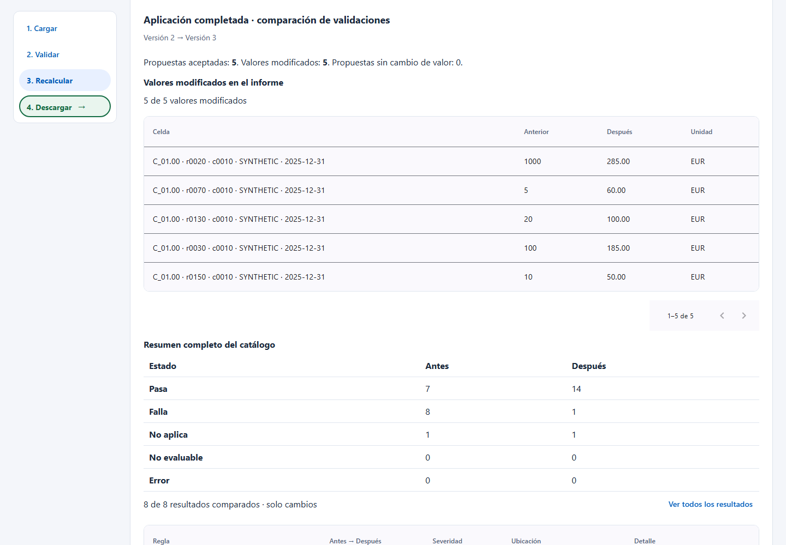
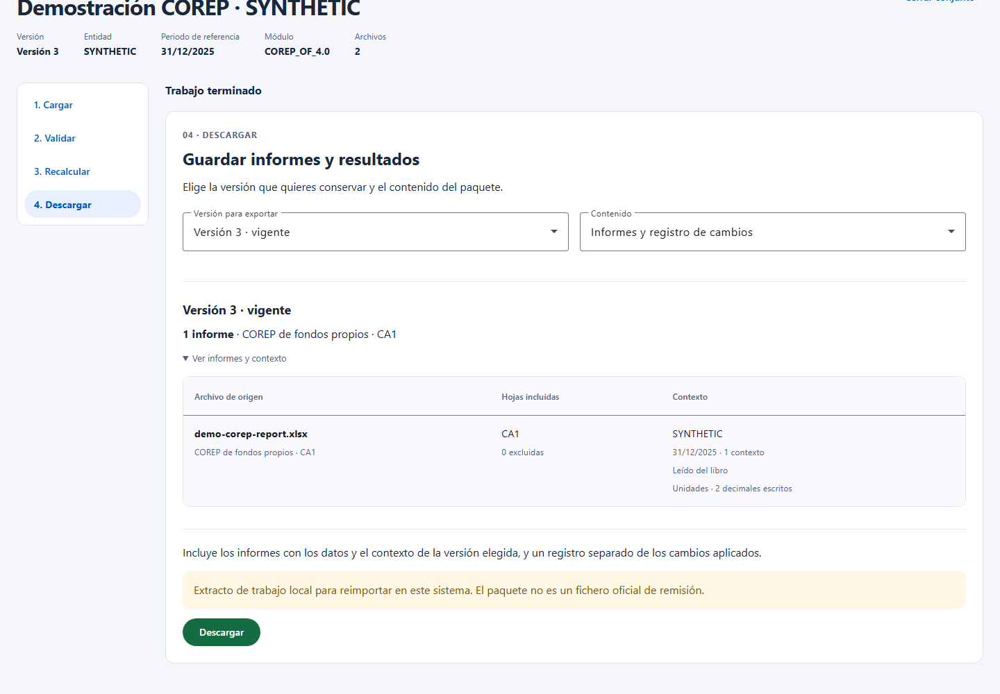

# ConsolidationEngine

Demo para validar informes regulatorios Excel y proponer recálculos explicables.
El analista carga un catálogo de reglas y sus informes, revisa los resultados y decide qué cambios aplicar.
El motor interpreta las reglas EBA con ANTLR y ordena sus dependencias mediante el algoritmo de Kahn.
Cada aplicación crea una versión y vuelve a validar; la descarga conserva los informes y el registro de cambios.
Incluye ejemplos sintéticos COREP, FINREP F 01.01 y reglas con texto y fechas.
Esta demo se ha desarrollado mediante Spec Driven Development (SDD), utilizando Spec Kit.
Las decisiones y su implementación se documentan en las [especificaciones, planes y tareas](specs/).

## Flujo de trabajo



1. **Cargar:** seleccionar catálogo e informes, revisar las hojas y confirmar la carga.
2. **Validar:** consultar qué reglas pasan, fallan o no aplican y abrir sus explicaciones.
3. **Recalcular:** resolver únicamente las decisiones pendientes en **Elegir qué celdas recalcular**, simular y revisar **Anterior → Propuesto**. Las propuestas disponibles comienzan seleccionadas; aplicar requiere confirmación explícita y dependencias completas.
4. **Descargar:** elegir versión y contenido, y utilizar un único botón para obtener el paquete.

Los destinos inequívocos se eligen automáticamente. Si hay alternativas o varias reglas proponen escribir en la misma celda, decide el analista. Las reglas con condicionales, texto, fechas o desigualdades **solo se validan**. Validar y simular no cambian los valores del informe.

## Tecnologías y arquitectura

| Capa | Tecnologías y responsabilidad |
| --- | --- |
| Interfaz | Angular 22, Angular Material y TypeScript: cuatro etapas, tablas, selección múltiple y accesibilidad. |
| API | Node.js 24 y Fastify 5: contratos, sesiones, archivos y coordinación de trabajos. |
| Motor | ANTLR 4.13.2 genera el parser JavaScript; evaluación con racionales exactos y dependencias ordenadas mediante Kahn. |
| Modo local | Memoria y archivos temporales; web y API servidas por un mismo proceso. |
| Modo alojado | PostgreSQL 17, objetos privados Vercel Blob y entregas firmadas QStash; frontend y backend en proyectos Vercel separados. |
| Verificación | Vitest, pruebas de Angular, Playwright y entornos Linux/PostgreSQL aislados con Docker. |



El diagrama representa la composición implementada. Los proveedores alojados aún no se han desplegado: las pruebas utilizan PostgreSQL real y adaptadores controlados de cola y objetos. En modo local no hacen falta servicios externos. La [arquitectura detallada](docs/architecture-005.md) explica los componentes y sus límites.

| Ubicación | Contenido |
| --- | --- |
| `apps/web` | Interfaz y recuperación del estado de navegación. |
| `apps/api` | API, workers, adaptadores locales y persistencia alojada. |
| `packages/engine` | Interpretación, validaciones, recálculos y dependencias. |
| `packages/contracts` | Tipos, esquemas y límites compartidos. |
| `grammar` | Gramáticas originales EBA, verificadas por hash. |
| `specs` | Especificaciones, planes, contratos y tareas de Spec Kit. |

## Instalación y arranque local

Requisitos: **Node 24.22.2, npm 11.19.1 y Java 11 o superior**. La comprobación Linux utiliza Java 17. En PowerShell de Windows x64, desde la raíz:

```powershell
.\scripts\bootstrap-toolchain.ps1
.\scripts\run-with-toolchain.ps1 -NpmArguments @('ci')
.\scripts\run-with-toolchain.ps1 -NpmArguments @('run','prepare:templates')
.\scripts\run-with-toolchain.ps1 -NpmArguments @('run','fixtures')
.\scripts\run-with-toolchain.ps1 -NpmArguments @('run','build')
.\scripts\run-with-toolchain.ps1 -NpmArguments @('start')
```

El bootstrap instala Node/npm en `.tools`, sin modificar las instalaciones globales. La primera preparación descarga dependencias y el JAR ANTLR verificado. Con las mismas versiones ya disponibles, en Linux o Windows:

```sh
npm ci
npm run prepare:templates
npm run fixtures
npm run build
npm start
```

Abrir [http://127.0.0.1:3000](http://127.0.0.1:3000). `build` genera el parser y empaqueta plantillas, demos y recursos; las peticiones no descargan fuentes regulatorias. Para desarrollo, detener ese servidor y ejecutar `npm run dev` —o el equivalente con `run-with-toolchain.ps1`— y abrir [http://127.0.0.1:4200](http://127.0.0.1:4200). Angular recarga la interfaz; los cambios del backend requieren reiniciar el comando.

El modo local recupera el conjunto al refrescar el navegador, pero pierde sus datos al cerrarlo o reiniciar el servidor. Descargar los informes que se deseen conservar.

## Demostraciones y cobertura

En **Cargar → Demostraciones guiadas**, descargar catálogo e informe del mismo ejemplo. Todos los datos son sintéticos; descargar los archivos no los importa automáticamente.

| Ejemplo | Reglas | Resultado inicial | Después de aplicar |
| --- | ---: | --- | --- |
| COREP CA1 | 16: cinco procedentes del catálogo EBA y once sintéticas | 7 pasan, 8 fallan y 1 no aplica | Cinco cambios: 14 pasan, 1 falla y 1 no aplica. |
| FINREP F 01.01 | 5 sintéticas | 2 pasan y 3 fallan | 90 → 100 y 105 → 120; 4 pasan y 1 falla deliberadamente. |
| Texto y fechas | 8 sintéticas | 6 pasan y 2 fallan | Solo validación; no ofrece recálculos. |

La [guía de demostraciones](docs/visual-demos.md) explica las decisiones, los cambios y los fallos deliberados. La cobertura visual está acotada a **COREP fondos propios 4.0, C_01.00 / CA1** (110 posiciones), **FINREP 4.0, F_01.01 / hoja 1.1** (38 posiciones) y el ejemplo tipado. No se afirma cobertura general de COREP, FINREP ni DPM-XL. La API mantiene compatibilidad con `ce-report-1`; ese formato anterior no se ofrece en la interfaz.

El paquete de informes incluye los Excel de la versión elegida y su registro de cambios. FINREP conserva el libro original y las hojas excluidas, sin considerarlas validadas. Los importes mantienen su valor exacto y escala; texto, fecha, vacío informado y ausencia de dato se distinguen. Los archivos son extractos de trabajo reimportables, **no ficheros oficiales de remisión**.

## Preparación de Vercel

La demo pública está diseñada para **datos sintéticos y sesiones anónimas independientes**. El navegador conserva credenciales e identificadores mínimos, sin guardar informes ni resultados. La API comprueba el propietario en cada acceso, aplica cuotas y autoriza orígenes CORS exactos.

| Proyecto | Root Directory | Comando de empaquetado desde la raíz |
| --- | --- | --- |
| Frontend | `apps/web` | `npm run package:vercel:web` |
| Backend | `apps/api` | `npm run package:vercel:api` |

Los archivos `vercel.json` fijan los comandos de instalación/build y las rutas. Configurar los valores públicos del frontend según [apps/web/.env.example](apps/web/.env.example), y los secretos solo en el backend según [apps/api/.env.example](apps/api/.env.example). La [guía de despliegue](docs/deployment-vercel.md) detalla PostgreSQL/Neon, Blob privado, QStash, CORS, mantenimiento, cuotas de planes gratuitos y comprobaciones previas. No se han creado cuentas, contratado ni desplegado servicios.

**Capacidad máxima pendiente:** con 2 GB y una CPU, validar 500 reglas sobre 100.000 hechos supera el plazo de 60 segundos. La exportación máxima, memoria y temporales pasan sus comprobaciones, pero la viabilidad alojada de ese volumen aún no está acreditada. No se han reducido límites ni activado planes de pago para ocultarlo.

Los límites de entrada son 10 MiB por archivo, 50 MiB por lote, 100 MiB expandidos y hasta 20 informes. La demo alojada limita además sesiones, trabajos, almacenamiento y consumo de proveedores. Las [medidas y su alcance](docs/verification-005.md) separan los recorridos funcionales, el rendimiento local, la capacidad alojada y el despliegue real pendiente.

## Pruebas

Después de preparar y construir el proyecto:

```sh
npm run typecheck
npm test
npm run test:e2e
npm run test:hosted
npm run test:e2e:hosted
npm run test:package:linux
npm run test:capacity:hosted
```

En Windows se pueden ejecutar mediante `run-with-toolchain.ps1`. Las pruebas de navegador requieren Chromium de Playwright; las alojadas, de empaquetado Linux y capacidad requieren Docker Desktop con contenedores Linux. El [quickstart de 005](specs/005-simplificar-flujo-vercel/quickstart.md) recoge preparación, comandos, puertos y escenarios reproducibles.

Los recorridos COREP, FINREP y texto/fechas se verificaron en local y con dos instancias de API sobre PostgreSQL. El paquete Linux pasa desde una instalación limpia. La referencia local de 500 reglas y 100.000 lecturas pasa 10/10 ejecuciones entre 16,4 y 22,8 s; no equivale a la capacidad del alojamiento con una CPU. `test:capacity:hosted` conserva el fallo de plazo indicado arriba. Consultar el [registro de verificación](docs/verification-005.md) para resultados, repeticiones y límites; las pruebas automáticas no se presentan como aceptación humana.

## Capturas del flujo

Capturas reales de la demo COREP con datos sintéticos, tomadas tras las comprobaciones de esta iteración.

<details>
<summary>1. Cargar: inspección y confirmación</summary>



</details>

<details>
<summary>2. Validar: resultados y explicación</summary>



</details>

<details>
<summary>3. Recalcular: comparación antes y después</summary>



</details>

<details>
<summary>4. Descargar: versión y una única acción</summary>



</details>

## Desarrollo con Spec Kit

El trabajo sigue **especificación → plan → tareas → implementación → verificación**, con commits por funcionalidades. La [constitución](.specify/memory/constitution.md) fija las garantías del motor; la iteración actual conserva su [especificación](specs/005-simplificar-flujo-vercel/spec.md), [plan](specs/005-simplificar-flujo-vercel/plan.md) y [tareas](specs/005-simplificar-flujo-vercel/tasks.md). Las gramáticas y fuentes originales EBA se mantienen intactas y verificadas por hash. La revisión por recibos permanece `disabled/unmanaged`; los checklists de Spec Kit son documentales.
