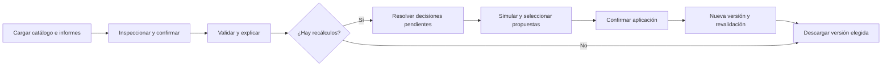
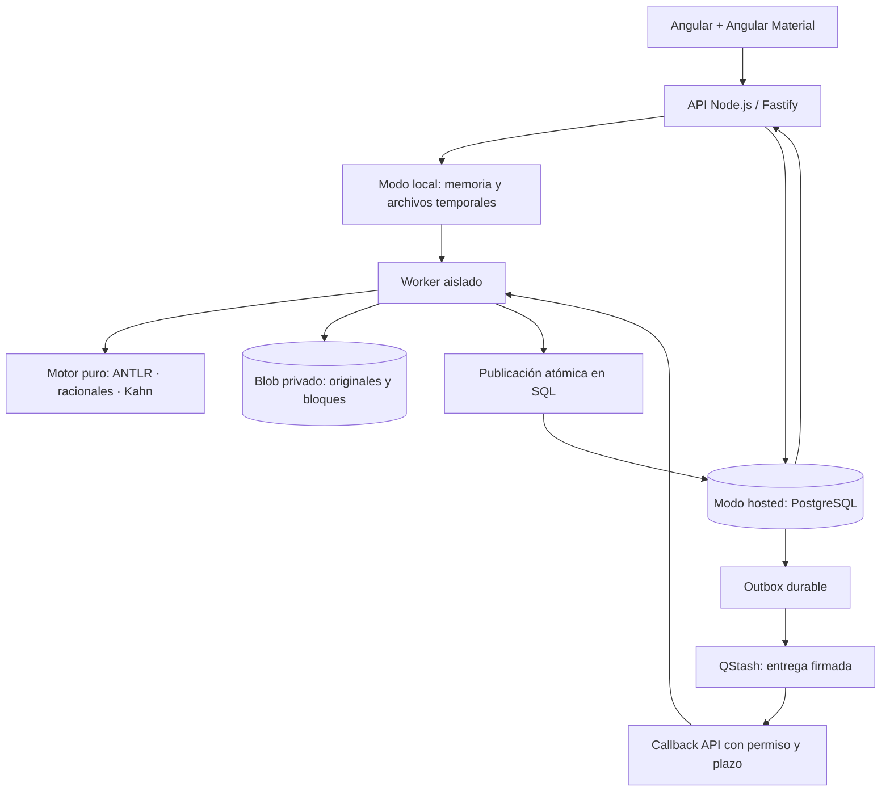

# Arquitectura de ConsolidationEngine

La aplicación separa la presentación, el motor regulatorio y la conservación de datos. Angular presenta decisiones y resultados; el motor TypeScript interpreta el árbol generado por ANTLR, trabaja con racionales exactos y ordena las dependencias mediante Kahn. Una validación nunca modifica el informe. La aplicación de propuestas publica una nueva versión junto con su revalidación.

## Flujo del analista



Las celdas inequívocas se eligen automáticamente; los destinos ambiguos y productores en conflicto requieren decisión del analista. Simular guarda configuración y propuestas de forma atómica. Aplicar exige selección vigente, antecedentes completos y confirmación explícita. Las reglas con condicionales, texto, fechas o desigualdades se validan sin ofrecer recálculos. La descarga se realiza desde su etapa y queda vinculada a versión, contenido y ejecución exactos.

## Componentes y modos de ejecución



El diagrama hosted representa la composición implementada y preparada para desplegar. Las pruebas usan PostgreSQL real y adaptadores controlados de cola/objetos; no acredita que los proveedores estén desplegados. El frontend y el backend se empaquetan en proyectos Vercel separados, con orígenes CORS explícitos. El modo local sirve ambos desde un proceso y no requiere servicios externos.

| Carpeta | Responsabilidad |
| --- | --- |
| `apps/web` | Cuatro etapas, accesibilidad, selección, estados de operaciones y descarga única. |
| `apps/api/src/routes` | Contratos HTTP, autenticación, admisión y consultas autorizadas. |
| `apps/api/src/hosted` | Autoridad SQL, sesiones independientes, cuotas, jobs, outbox, objetos y limpieza. |
| `apps/api/src/local` | Adaptadores locales y paridad de respuestas compactas. |
| `apps/api/src/workers` | Carga, validación, simulación, selección, aplicación y exportación fuera del hilo HTTP. |
| `packages/engine` | Evaluación sin efectos, políticas de recálculo y dependencias. |
| `packages/contracts` | Tipos, esquemas y límites compartidos. |
| `grammar` | Fuentes EBA inmutables usadas para generar el parser JavaScript. |
| `specs/005-simplificar-flujo-vercel` | Especificación, plan, decisiones y tareas de esta iteración. |

Una sesión hosted se acredita con un secreto generado en el navegador, independiente de otras pestañas/visitantes. Solo se conservan credenciales e identificadores mínimos en `sessionStorage`; nunca informes ni resultados de negocio. SQL se consulta en cada acceso: conocer un ID no concede permiso. Los trabajos tienen idempotencia, revisión de base y un límite de 60 s que incluye I/O y publicación; cancelar o fallar no publica resultados parciales.

Las vistas públicas usan páginas de hasta 50 elementos y JSON de hasta 1 MiB. Los valores grandes y archivos se recuperan por partes autorizadas con hashes. Los originales FINREP se conservan; el historial de exportación lee metadatos de ancestros sin hidratar veinte informes completos. Los presupuestos de objetos, SQL, operaciones y limpieza se controlan por separado.

## Construcción y arranque reproducibles

Requisitos: Node 24.22.2, npm 11.19.1 y Java ≥11. El bootstrap de Windows instala Node/npm en `.tools` y verifica sus hashes; no modifica instalaciones globales. En Linux, utilizar las mismas versiones. Desde la raíz:

```sh
npm ci
npm run prepare:templates
npm run fixtures
npm run build
npm start
```

El servidor local escucha en `http://127.0.0.1:3000`; `PORT` permite elegir otro puerto. Para desarrollo, `npm run dev` inicia Angular en 4200 y API en 3000. `build` genera el parser con ANTLR 4.13.2 y prepara los assets; no hay generación ni descarga de fuentes regulatorias durante las peticiones.

`test:package:linux` instala desde el lockfile en un entorno limpio, verifica originales y ocho archivos generados reproducibles y ejecuta todas las clases de trabajo en un runtime aislado sin red ni checkout vecino. Las medidas efectivas y sus límites están en [verification-005.md](verification-005.md). El arranque documentado se verifica automáticamente, no mediante una observación humana inventada.

Para alojar la demo: [configuración y operación de los dos proyectos](deployment-vercel.md). Para repetir las comprobaciones: [quickstart de 005](../specs/005-simplificar-flujo-vercel/quickstart.md). La comprobación de capacidad y la validación de servicios reales son gates distintos; un build correcto no los sustituye.
