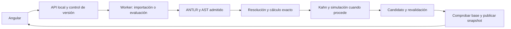

# Implementation Plan: Validación y recálculo de informes regulatorios

**Branch**: `main` | **Date**: 2026-10-31 | **Spec**: [spec.md](spec.md)

**Input**: `specs/001-regulatory-validation/spec.md`.
**Feature**: `001-regulatory-validation`. El script de Spec Kit identifica la feature con ese
nombre; la rama Git real sigue siendo main. Estado: fases 0 y 1 de planificación completadas;
sin implementación ni tasks.md.

## Summary

Aplicación web local para importar un catálogo reducido de reglas EBA y reportes en una plantilla
propia, evaluar un perfil explícito de DPM-XL y proponer recálculos dirigidos por el usuario.
Angular presenta cobertura, resultados y cambios; Node.js posee los datos, coordina trabajos y
publica snapshots. Un motor puro interpreta AST generado desde ANTLR, resuelve coordenadas,
evalúa racionales/intervalos y ordena recálculos con Kahn.

Los recálculos no se deducen automáticamente de cualquier igualdad. Se simulan sobre una copia,
se muestran sus dependencias y se aplican solo tras confirmación coherente, comprobación de versión
y revalidación. El perfil incluye una diferencia numérica explícita respecto de fórmulas
inconsistentes observadas en el PDF v0.9; está descrita en research R3 y en el contrato del lenguaje.
No se declara conformidad literal completa con toda la documentación EBA.

## Technical Context

**Language/Version**: TypeScript 6.0.3 estricto; JavaScript ESM generado; Node 24.22.2 y npm 11.19.1.
Java 11+ solo para ANTLR, generación de referencia con JDK 17 y versión exacta registrada.

**Primary Dependencies**: Angular 22.2.4/CLI-build 22.2.5, RxJS 7.8.2, Fastify 5.12.7,
multipart 10.1.6/static 10.1.8, ANTLR 4.13.2 herramienta/runtime, read-excel-file 9.3.14,
write-excel-file 4.1.1, yauzl 3.4.0 y sax 1.6.1. Pins y fuentes: [research R1](research.md#r1-versiones-y-organización).

**Storage**: Un workspace efímero por proceso, snapshots inmutables en memoria y temporales locales.
Sin DB, sin recuperación entre reinicios. Exportaciones elegidas por el usuario sobreviven al cierre.

**Testing**: Vitest 5.0.5, jsdom 30.1.3 y Playwright 1.64.1/Chromium. Pruebas de semántica, importación,
contratos HTTP, generación reproducible, concurrencia/cancelación y recorrido de usuario.

**Target Platform**: Windows local, Node loopback y navegador Chromium; estructura portable,
sin afirmar validación en otros sistemas. Funcionamiento de producto sin servicios externos.

**Project Type**: Monorepo web con npm workspaces; frontend, API, motor y DTO compartidos.

**Performance Goals**: 500 reglas admitidas/100.000 hechos; 9 de 10 ejecuciones en ≤30 segundos,
cancelación y corte a 60 segundos. Objetivos pendientes de medición, no garantías demostradas.

**Constraints**: Originales intactos; sin eval, macros ni fórmulas Excel; operaciones numéricas
exactas y perfil versionado; una tarea CPU activa; publicación atómica; sin despliegue público.
Cuotas: [workbook](contracts/workbook.md#preflight-y-cuotas-de-archivos),
[lenguaje](contracts/language-profile.md#límites-y-casos-de-referencia) y
[sesión](data-model.md#capacidad-y-limpieza).

**Scale/Scope**: Un analista, una entidad/fecha por conjunto, hasta 20 informes, tablas cerradas,
un subconjunto numérico/booleano. Fuera: tablas abiertas, filtros/agrupaciones generales, XBRL,
remisión oficial, álgebra general, iteración de ciclos, colaboración y persistencia multiusuario.

## Constitution Check

Comprobación previa: las cinco reglas constitucionales permitían investigar este diseño sin
excepciones. Comprobación posterior: el diseño satisface sus obligaciones documentales mediante
los artefactos siguientes. «Satisface» se refiere al diseño, no a código o pruebas inexistentes.

| Principio | Antes de investigar | Evidencia posterior al diseño |
| --- | --- | --- |
| I. Semántica explícita/cobertura | Separar parseo y evaluación; preservar originales. | Perfil whitelist, errores de lexer/parser, no eval, discrepancia numérica visible y source-notes. |
| II. Reproducibilidad | Versionar entradas/configuración y aritmética. | Racionales exactos, pins, claves canónicas, snapshots y contratos de datos/precisión. |
| III. Recálculo controlado | Vista previa y aceptación sobre copia. | API de selección cerrada, If-Match/idempotencia, publicación tras revalidación y cancelación sin efectos parciales. |
| IV. Dependencias verificables | Productores/consumidores reales y Kahn. | Reads de ámbito/precondición, conflictos previos, Kahn estable y SCC para residuo. |
| V. Evidencia incremental | Distinguir objetivos, fixtures y pruebas. | Quickstart futuro, matriz FR inferior, commits por funcionalidad; ninguna prueba del motor declarada ejecutada. |

No se requieren excepciones constitucionales. El perfil local de intervalos cumple la obligación
de semántica documentada y cobertura honesta; no se presenta como una corrección oficial EBA.
La revisión por recibos permanece `disabled/unmanaged`. No existen hooks before_plan/after_plan.

## Project Structure

### Documentation (this feature)

```text
specs/001-regulatory-validation/
├── spec.md
├── plan.md
├── research.md
├── data-model.md
├── quickstart.md
├── source-notes.md
├── checklists/requirements.md
└── contracts/
    ├── http-api.md
    ├── workbook.md
    └── language-profile.md
```

`tasks.md` se generará únicamente en la siguiente fase `$speckit-tasks`.

### Source Code (repository root)

Estructura **propuesta**, todavía no creada:

```text
apps/
├── web/src/app/           # carga, resultados, recálculo, sesión; Signals/HttpClient
└── api/src/               # routes, session store, jobs, workers, import/export adapters
packages/
├── engine/src/            # AST, resolver, numeric, evaluator, dependency graph, simulation
│   └── generated/         # lexer/parser/visitor JS derivados; no editar ni versionar
└── contracts/src/         # DTO/esquemas de app, estados y serialización exacta
scripts/                  # generación ANTLR, fixtures y verificación de fuentes
tests/
├── fixtures/              # reglas seleccionadas + datos sintéticos
├── contract/
├── integration/
├── e2e/
└── performance/
grammar/                  # fuentes originales existentes, inmutables
```

**Structure Decision**: El motor no importa HTTP, filesystem ni Angular. API depende de motor
y DTO; web depende de DTO, sin incluir el evaluador en el navegador. Los adaptadores XLSX viven
en API y entregan datos normalizados al motor. El paquete compartido no almacena estado de sesión.
No se añaden Nx, colas externas ni una capa genérica de repositorios.

### Flujo de ejecución



La validación ordinaria no requiere el paso del grafo. El worker devuelve datos y diagnósticos;
solo el hilo principal cambia el puntero vigente. Timeout/cancelación antes de publicar descarta
el candidato. Los resultados se consultan paginados por versión, no mediante respuestas gigantes.

### Secuencia de construcción prevista

Primero establecer workspaces/pins/generación y un corte de importación verificable; después
construir el perfil semántico con fixtures y exponer validación; añadir direcciones/grafo/preview;
por último aplicación atómica, comparación/exportación y recorrido completo. Esta secuencia guía
la siguiente fase de tareas; no constituye una lista de tareas ya ejecutadas.

| Requisito | Decisión principal | Comprobación prevista |
| --- | --- | --- |
| FR-001 | Adaptador EBA con campos/procedencia exactos. | V01/V04 y fixture de cabeceras/fechas. |
| FR-002 | Variantes/contextos/vigencia e identidad estable. | V04, duplicados equivalentes/conflictos, permutación. |
| FR-003 | ce-report-1 y catálogo cerrado. | V01/V03/V14. |
| FR-004 | Staging y reemplazo atómico. | V01/V13. |
| FR-005 | Capacidades/profileId y diagnóstico por regla. | V12 y resumen de cobertura. |
| FR-006 | AST admitido y semántica acotada. | V02/V03/V05/V15. |
| FR-007 | Racionales, intervalos, null y unidades. | V05/V07/V14/V15. |
| FR-008 | Estados separados de severidad. | Tabla completa de estados con errores/indeterminados. |
| FR-009 | Resultado paginado con valores/fuentes/versiones. | Conciliación de totales y V16. |
| FR-010 | Snapshots/orden canónico. | V04/V10/V11 y repetición con mismas entradas. |
| FR-011 | Destino elegido y candidato que satisface origen. | V06/V07 y desigualdad sin propuesta. |
| FR-012 | Lecturas completas y Kahn estable. | V06/V09 y permutación del grafo. |
| FR-013 | Conflictos/SCC/descendientes. | V08/V09. |
| FR-014 | Preview y clausura visible. | V06 y petición de selección incompleta. |
| FR-015 | If-Match/idempotencia/publicación única. | V10/V11. |
| FR-016 | Revalidación completa/exportación. | V06/V16. |
| FR-017 | Cuotas y worker cancelable. | V11/V13 y benchmark separado. |
| FR-018 | Preflight y limpieza local. | V13/V14/V16. |

## Complexity Tracking

Sin violaciones constitucionales ni excepciones que justificar. Los cuatro workspaces separan
dos aplicaciones, el cálculo reutilizable y los contratos. La aritmética racional, el preflight
y SCC responden a necesidades concretas de exactitud, límites de archivos y diagnóstico de ciclos.
