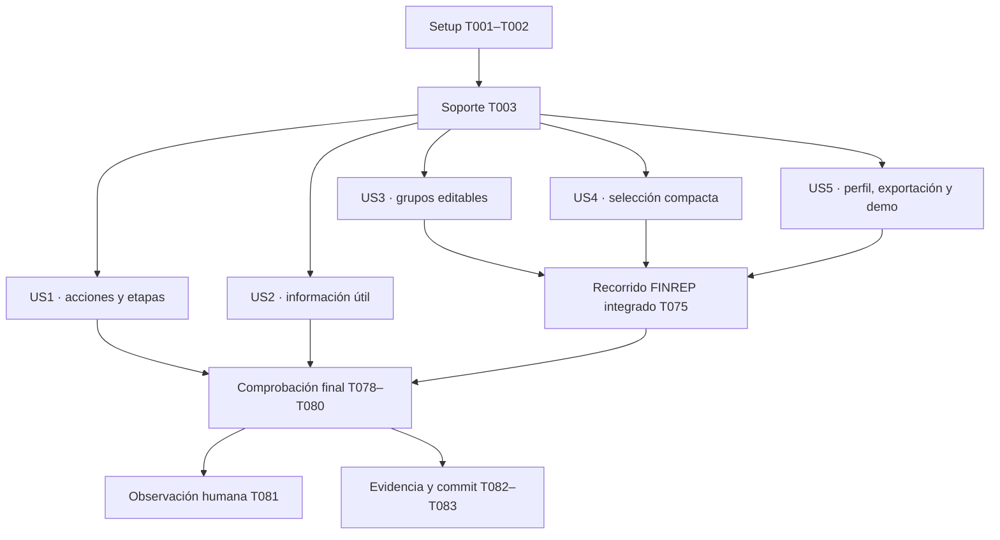

# Tasks: Acciones claras, selección de recálculos y FINREP F 01.01

**Input**: [spec.md](spec.md), [plan.md](plan.md), [research.md](research.md), [data-model.md](data-model.md), [contracts/](contracts/) y [quickstart.md](quickstart.md).

**Branch**: `codex/004-flujo-claro-finrep` · **Fecha**: 2026-11-07 · **Estado**: Implementación en curso; casillas actualizadas según evidencia.

**Tests**: La especificación solicita pruebas verificables SC-001–010 y el plan define contratos, integración, navegador y volumen. Se incluyen antes de los cambios que comprueban; el fallo inicial debe corresponder al comportamiento ausente, no a archivos corruptos, fixtures erróneos o un entorno sin preparar.

**Organization**: Cinco historias P1, cada una con objetivo, prueba independiente y cierre. Las rutas son relativas a la raíz del repositorio. Los archivos identificados como nuevos y las nuevas suites se crean durante implementación; no se presume que existan ahora.

## Formato y reglas de ejecución

- `- [ ] Tnnn [P] [USn] descripción`: IDs consecutivos; `[USn]` solo en tareas de historia; `[P]` solo en tareas de archivos separados que pueden coincidir tras completar sus dependencias.
- Las dependencias indicadas son previas al comienzo de cada tarea. Las tablas y ejemplos de paralelismo no autorizan dos escritores en el mismo archivo ni cambiar el orden de contratos → productores → consumidores.
- Las referencias normativas de cada tarea son los contratos de diseño. Los límites, estados y restricciones citados no se reinterpretan al implementar.
- Mantener Node/Angular/ANTLR/Kahn y versiones fijadas, originales oficiales, sesión local, atomicidad y confirmación de escritura. Condicionales/texto/fechas/desigualdades siguen siendo solo validación.
- Guardar commits de grupos coherentes con las comprobaciones ejecutadas; no esperar al final de una historia grande para registrar incrementos verificados. No publicar un remoto.
- Cada checkbox acredita una tarea terminada, no una intención. Un test omitido, medición de fixture o aceptación humana pendiente se registra como tal.
- El desarrollo con recibos sigue `disabled/unmanaged`; esta lista no habilita ese flujo.

## Phase 1: Setup

**Objetivo**: Comprobar el checkout y preparar solo lo que falte; no reinicializar el proyecto ni actualizar versiones.

- [X] T001 Verificar rama, árbol de trabajo, versiones fijadas y disponibilidad de la toolchain mediante `package.json`, `scripts/bootstrap-toolchain.ps1` y `scripts/run-with-toolchain.ps1`; registrar commit y entorno en `docs/verification-004.md` (nuevo). Preparar dependencias solo si faltan y conservar los procesos/conjuntos del analista.
- [X] T002 Contrastar las huellas de originales con `tests/fixtures/eba/source-manifest.json` y de demos actuales con `assets/demos/manifest.json`; registrar la base y las limitaciones FINREP actuales en `docs/verification-004.md`. Reservar pruebas en 3318/3317 y un puerto manual libre, sin reutilizar 3330 ni sobrescribir evidencias anteriores. (Depende de T001).

## Phase 2: Foundational — soporte común de pruebas

**Objetivo**: El motor, sesión, jobs y snapshots ya existen. No se añade infraestructura de producto antes de las historias; solo se prepara soporte de aceptación compartido.

- [X] T003 Preparar los escenarios comunes y el aislamiento de workspace en `tests/helpers/iteration004-fixtures.ts` (nuevo), reutilizando `tests/helpers/xlsx-fixtures.ts`, `tests/helpers/corep-fixtures.ts` y `tests/e2e/workflow-helpers.ts`; definir casos de 2/3/51 productores, 51 propuestas y contextos distinguibles, sin depender de la futura API de selección. En API/UI, los contextos comparten entidad/fecha y se distinguen por otros atributos admitidos; comprobar entidades/periodos diferentes entre conjuntos o como rechazo del lote. Mantener separados fixtures sembrados y recorridos integrales. (Depende de T002).

## Phase 3: US1 — acción principal y etapa recomendada (P1, MVP)

**Objetivo**: Distinguir la acción que permite avanzar y la siguiente etapa, conservando control, foco y accesibilidad.

**Prueba independiente**: Carga, guardado y aplicación confirmados señalan Validar/Recalcular/Descargar; fallos no adelantan. Tres pulsos de 1,5 s, cero con movimiento reducido; como máximo una acción verde habilitada, contraste y teclado a 320/390/1440 px. SC-001–002.

### Pruebas antes de implementación

- [X] T004 [P] [US1] Ampliar `apps/web/src/app/workspace/workspace-view.store.spec.ts` con hitos repetidos/tardíos, remontaje, visita de etapa, otra base y dos operaciones para la misma recomendación; verificar deduplicación del anuncio/pulso y conservación de la versión de descarga. (Depende de T003).
- [X] T005 [P] [US1] Crear `tests/e2e/workflow-guidance.spec.ts` para tres hitos, foco/teclado, ausencia de «Siguiente paso», contraste renderizado y jerarquía de acciones a 320/390/1440 px; comprobar tres ciclos/4,5 s y movimiento reducido sin animación. Usar resultados confirmados y casos de fallo/cancelación. (Depende de T003).
### Implementación y cierre

- [X] T006 [US1] Definir `ce-primary-action` en `apps/web/src/styles.scss` con overrides públicos Material 22.2.4: verde #146c43/blanco, interacción #105835, foco #175caa y deshabilitado del contrato UI. Conservar tema base, texto ≥4,5:1 e indicadores ≥3:1; no estilizar destructivos como avance. (Depende de T004, T005).
- [X] T007 [US1] Ampliar `apps/web/src/app/workspace/workspace-view.store.ts` con identidad y tiempo del realce por workspace/operación/base/versión; aplicar «A lo sumo una» recomendación y «Tres ciclos de 1,5 s; máximo 4,5 s. Sin pulso para movimiento reducido». La etapa actual «import / validation / preview / exports» solo cambia por navegación del usuario. Una lectura o respuesta duplicada no lo reinicia y el foco no cambia por publicar. (Depende de T004).
- [X] T008 [US1] Sustituir el badge en `apps/web/src/app/workspace/workspace-shell.component.html`, `apps/web/src/app/workspace/workspace-shell.component.ts` y `apps/web/src/app/workspace/workspace-shell.component.scss` por borde/fondo/indicador de la etapa completa, manteniendo aria-current y anuncio único. Animar solo el adorno, conservar botones montados y soportar reduced-motion/forced-colors. (Depende de T006, T007).
- [X] T009 [US1] Aplicar la tabla de acciones principales de spec.md en `apps/web/src/app/import/import-page.component.html`, `apps/web/src/app/validation/validation-page.component.html`, `apps/web/src/app/recalculation/directions.component.html`, `apps/web/src/app/recalculation/preview-page.component.html`, `apps/web/src/app/recalculation/apply.component.html` y `apps/web/src/app/recalculation/exports.component.html`; como máximo una acción verde habilitada por estado, con requisitos visibles y descarga ligada a la versión aplicada. (Depende de T006, T008).
- [X] T010 [US1] Ejecutar las pruebas focales de US1 y registrar contrastes, tiempos, foco y capturas en `docs/verification-004.md`; corregir regresiones y guardar un commit acotado del incremento. No marcar SC-001–002 por comprobar únicamente clases CSS. (Depende de T009).

**Checkpoint**: cerrar la historia con la prueba independiente y las tareas de integración que le correspondan. Conservar la evidencia en `docs/verification-004.md`.

## Phase 4: US2 — información útil y explicaciones legibles (P1)

**Objetivo**: Eliminar contenido técnico visible conservando los datos y avisos que permiten revisar o corregir el trabajo.

**Prueba independiente**: Recorrer cuatro etapas, comparación y detalle sin IDs/huellas/volcados; exclusión, límite, caducidad, redondeo, cierre, fallo y progreso incompleto mantienen explicación y acción. SC-003.

### Pruebas antes de implementación

- [X] T011 [P] [US2] Ampliar `apps/web/src/app/workspace/workspace-shell.component.spec.ts` y `apps/web/src/app/shared/calculation-detail.component.spec.ts` para retirar progreso solo cuando el resultado de esa operación sea visible y conservar decimal exacto/origen/efecto de redondeo sin el bloque técnico. (Depende de T003).
- [X] T012 [P] [US2] Crear `tests/e2e/useful-information.spec.ts` con identificadores sintéticos conocidos para detectar su exposición en texto visible de carga, validación, propuesta, comparación y descarga; cubrir exclusiones, caducidad, error, temporalidad y valores con intervalo. No confundir IDs DOM/ARIA con información visible. (Depende de T003).
### Implementación y cierre

- [X] T013 [US2] Retirar el botón/panel Información técnica y estado asociado en `apps/web/src/app/import/import-page.component.html` y `apps/web/src/app/import/import-page.component.ts`; conservar contexto, cobertura/exclusiones, restricciones útiles junto a archivos y diagnósticos accionables. Actualizar `apps/web/src/app/import/import-inspection.spec.ts` para los controles retirados. (Depende de T011, T012).
- [X] T014 [US2] Retirar IDs de sesión/versión en `apps/web/src/app/workspace/workspace-shell.component.html` y mantener aviso breve de temporalidad al crear/cerrar en `apps/web/src/app/app.component.ts` y el propio shell; usar versión legible, nunca UUID como fallback. Conservar contexto único de lectura y selector cuando haya varios. (Depende de T013).
- [X] T015 [US2] Simplificar resumen de ejecución y grafo en `apps/web/src/app/validation/validation-page.component.html` y `apps/web/src/app/recalculation/preview-page.component.html`: quitar IDs/políticas internas y variantes/aristas; mantener estados de negocio, propuestas bloqueadas y dependencias necesarias. (Depende de T014).
- [X] T016 [US2] Retirar identificadores también en `apps/web/src/app/recalculation/comparison.component.html`, `apps/web/src/app/recalculation/apply.component.html` y `apps/web/src/app/recalculation/exports.component.html`; presentar anterior → después, versión numerada, contenido del paquete y origen previo legible sin borrar la trazabilidad del servidor. (Depende de T015).
- [X] T017 [US2] Eliminar Detalle técnico/volcado de `apps/web/src/app/shared/calculation-detail.component.html` y `apps/web/src/app/shared/calculation-detail.component.ts`; conservar expresión, valores exactos, origen y explicación pertinente de redondeo/intervalo. El detalle de validación mantiene su contrato; la nueva explicación de propuestas se integrará en US4. (Depende de T016).
- [X] T018 [US2] Registrar presentación efectiva del resultado por job/workspace/versión en `apps/web/src/app/workspace/workspace-view.store.ts` y `apps/web/src/app/workspace/workspace-shell.component.ts`, conectando los resultados en `apps/web/src/app/import/import.store.ts`, `apps/web/src/app/validation/results.store.ts` y `apps/web/src/app/recalculation/preview.store.ts`; ocultar solo progreso exitoso redundante, nunca fallo, cancelación o incompletitud. (Depende de T017).
- [X] T019 [US2] Ejecutar casos de US2 y regresiones afectadas de información/contexto, documentar SC-003 en `docs/verification-004.md` y guardar un commit acotado. Identificar los avisos visibles y verificar que originales, valores y contratos de auditoría siguen intactos. (Depende de T018).

**Checkpoint**: cerrar la historia con la prueba independiente y las tareas de integración que le correspondan. Conservar la evidencia en `docs/verification-004.md`.

## Phase 5: US3 — conflictos comparables y editables (P1)

**Objetivo**: Conservar los grupos resueltos para consultar, cambiar u omitir su productor sin perder candidatos ocultos.

**Prueba independiente**: Resolver/reabrir grupos de 2, 3 y 51 candidatos; elegir el candidato 51 y después otro; omitir y recuperar; impedir el traslado silencioso desde otro destino; cero escrituras de hechos. SC-004.

### Pruebas antes de implementación

- [X] T020 [P] [US3] Crear `tests/contract/direction-conflict-groups.spec.ts` para las tres lecturas de grupos/candidatos/detalle y resolveGroup editable; cubrir schemas cerrados, límites 50/200, cursor, ownership, TTL, CAS, replay y GROUP_CANDIDATE_ASSIGNED_ELSEWHERE. (Depende de T003).
- [X] T021 [P] [US3] Crear `packages/engine/test/direction-conflict-groups.spec.ts` con catálogo estable/miembros activos/grupos observados, 2/3/51 candidatos, ambos lados misma celda, contextos separados, omisión global y candidato asignado a otro destino; las decisiones no alteran hechos. (Depende de T003).
- [X] T022 [P] [US3] Ampliar `apps/web/src/app/recalculation/directions.component.spec.ts` con borrador local, radio por teclado sin PATCH, confirmar/cancelar, edición tras resolver, candidato fuera de página y guardado deshabilitado con elección pendiente; añadir recuperación de errores y foco. (Depende de T003).
### Implementación y cierre

- [X] T023 [US3] Ampliar `packages/contracts/src/direction-review.ts`, `packages/contracts/src/errors.ts` e `packages/contracts/src/index.ts` con grupos/candidatos/detalle y error assignedElsewhere. Preservar state «conflicted / resolved / omitted / pending», selectedCandidate opcional «Ganador elegido o ausencia», recuentos «Totales completos, no tamaño de la página»; límites 1–200/predeterminado 50, cursor 8192, previews 512 y textos originales 32767. (Depende de T020, T021, T022).
- [X] T024 [US3] Separar candidatos elegibles, miembros activos y grupos observados en `packages/engine/src/recalculation/direction-review-index.ts`; catálogo «Estable durante la revisión; cada opción debe seguir siendo elegible para esta base», target/contexto completo, omisión explícita y grupo consultable tras resolver. Con ambos lados en la misma celda «se presenta un candidato único con el lado activo o una elección estable definida en el contrato». Contabilizar índices adicionales sin duplicar presentación. (Depende de T023).
- [X] T025 [US3] Extender resolveGroup/omitAll en `packages/engine/src/recalculation/direction-review.ts` y el índice para reeditar grupos resolved/omitted/pending; ganador nulo omite, candidato assignedElsewhere se rechaza y solo se omiten otros productores activos de este destino. Reutilizar copy-on-write, cuota y revisión atómica. (Depende de T024).
- [X] T026 [US3] Proyectar grupos, candidatos y detalle bajo demanda en `apps/api/src/recalculation/direction-review-service.ts` y `apps/api/src/presentation/rule-presentation.ts`; ordenar estable por destino/contexto y código/instancia, deduplicar descripciones, respetar límites y TTL de 15 minutos sin cargar todas las lecturas. (Depende de T025).
- [X] T027 [US3] Registrar GET groups, candidates y candidato individual en `apps/api/src/routes/direction-reviews.ts`, con schemas, cursores firmados por revisión/grupo, ownership y serialización permitida; conservar PATCH compatible y replay antes de validar revisión esperada, devolviendo errores curados del contrato. (Depende de T026).
- [X] T028 [US3] Añadir cliente y estado paginado de grupos en `apps/web/src/app/core/api-client.ts` y `apps/web/src/app/recalculation/directions.store.ts`; conservar un editor local, revisión leída y candidato/omisión al paginar; bloquear guardado e impedir reenvíos nuevos durante incertidumbre, conservando la mutación original para reintentar. (Depende de T027).
- [X] T029 [US3] Rehacer `apps/web/src/app/recalculation/directions.component.ts` y `apps/web/src/app/recalculation/directions.component.html` con MatRadio, descripción/expresión consultable, No recalcular esta celda, Confirmar elección secundario y resumen Cambiar elección. Mantener tarjeta/foco, un editor máximo y controles de detalle fuera de la etiqueta del radio; retirar Conservar. (Depende de T028).
- [X] T030 [US3] Crear `tests/e2e/conflict-decisions.spec.ts` y adaptar `tests/e2e/direction-review-helpers.ts` para elegir/reabrir/omitir incluso en segunda página; confirmar COREP con v0174_m en r0070 y omitir r0200: cinco incluidas, cuatro omitidas y siete excluidas. Actualizar las instrucciones pertinentes en `docs/visual-demos.md`. (Depende de T029).
- [X] T031 [US3] Ejecutar contratos, motor, Angular y recorrido focal de US3; añadir carreras/caducidad/cuota sin publicación parcial a `tests/integration/direction-review-lifecycle.spec.ts`, registrar SC-004 en `docs/verification-004.md` y guardar el commit del incremento. (Depende de T030).

**Checkpoint**: cerrar la historia con la prueba independiente y las tareas de integración que le correspondan. Conservar la evidencia en `docs/verification-004.md`.

## Phase 6: US4 — selección múltiple y aplicación por revisión (P1)

**Objetivo**: Preseleccionar una nueva simulación una sola vez, editar selecciones de todas las páginas y aplicar solo una revisión aceptada y vigente.

**Prueba independiente**: Cinco propuestas COREP preseleccionadas, casos de 51/100.000 seleccionables, filtros/contexto/recarga sin restaurar deselecciones, cierre transitivo, aceptación invalidada y aplicación atómica. SC-005–006.

### Pruebas antes de implementación

- [X] T032 [P] [US4] Crear `tests/contract/proposal-selection.spec.ts` para resumen, edición, filas/dependencias/explicación paginadas, revisión/cursor/ownership y límites; ampliar `tests/contract/application-schemas.spec.ts` y `tests/contract/applications-exports.spec.ts` con unión array/ref exclusiva y recibos compactos compatibles. (Depende de T003).
- [X] T033 [P] [US4] Crear `packages/engine/test/proposal-selection.spec.ts` con máscaras JSON/base64, inicialización única, set/selectMatching/clear, 51 filas, A→B→C, más de 50 antecedentes directos, bloqueadas y cierre entre contextos; verificar cero incorporación automática al desmarcar y WorkBudget. (Depende de T003).
- [X] T034 [P] [US4] Crear `tests/integration/proposal-selection-lifecycle.spec.ts` para publicación conjunta preview/selección, fallo antes de publicar, dos revisiones, replay, cancelación/timeout, cambio de base, cierre y preview antiguo sin registro; distinguir preparación explícita vacía de GET sin efectos. (Depende de T003).
- [X] T035 [P] [US4] Crear `apps/web/src/app/recalculation/proposal-selection.store.spec.ts` para cinco preseleccionadas, recuentos fuera de filtro/página, estado parcial, respuesta antigua, recuperación/recarga, filtro vacío y quitar/añadir invalidando aceptación aunque coincida la huella. (Depende de T003).
- [X] T036 [P] [US4] Crear `tests/e2e/bulk-selection.spec.ts` con 51 propuestas/antecedente oculto, selección de todas las páginas del filtro, limpieza global, dependencia bloqueante, consulta histórica y aplicación por referencia; probar que aceptación empieza desmarcada y ediciones se bloquean ante respuesta incierta. (Depende de T003).
### Implementación y cierre

- [X] T037 [US4] Crear `packages/contracts/src/proposal-selection.ts` y exportarlo en `packages/contracts/src/index.ts`: UUID/ownership; revision «Entero monotónico: 0 mientras no existe revisión publicada (preparing o failed), positivo a partir de ready; cada edición publicada tiene una revisión nueva»; state «preparing / ready / updating / applying / applied / obsolete / discarded / failed»; initializationJobId/pendingJobId opcionales, contadores «omitidos si todavía no hay revisión publicada; no simular ceros» y closureHash 64 hex. Definir filas compactas sin arrays globales. (Depende de T032, T033, T034, T035, T036).
- [X] T038 [US4] Completar schemas de consultas/explicación en `packages/contracts/src/proposal-selection.ts` y ampliar `packages/contracts/src/application.ts`, `packages/contracts/src/recalculation.ts`, `packages/contracts/src/common.ts`, `packages/contracts/src/common.schemas.ts`, `packages/contracts/src/errors.ts`: select-proposals, errores nuevos, unión exclusiva array/selectionRef, compact receipt e includeAcceptedIds. Fijar set 1–200 sin duplicados, selectMatching/clear únicos, páginas 50/máximo 200, cursor 8192, code/table 128, contextId [A-Za-z0-9_-]{1,64}, descripción 500, textos originales 32767, diagnóstico 4096 y resumen/página de explicación ≤1 MiB. (Depende de T037).
- [X] T039 [US4] Implementar `packages/engine/src/recalculation/proposal-selection.ts` (nuevo) y exportar en `packages/engine/src/index.ts`: «Orden topológico estable de las propuestas del PreviewBundle; incluye pertenencia de cada propuesta/contexto», bloques base64 inmutables de 4 KiB y máscara de disponibles/seleccionadas/requeridas; cero bits fuera de cardinalidad, sin duplicar ProposalDTO, cierre transitivo con presupuesto y métodos set/selectMatching/clear que preservan deselecciones. (Depende de T038).
- [X] T040 [US4] Crear `apps/api/src/recalculation/proposal-selection-record.ts` y `apps/api/src/recalculation/proposal-selection-service.ts` con registro único por preview/base/workspace: «Pertenencia y aislamiento. La selección no puede trasladarse a otra base.», CAS, revisión candidata y reservas; integrar JSON canónico/cuota en `apps/api/src/session/workspace-store.ts`, `apps/api/src/session/canonical-state.ts` y `apps/api/src/session/retained-size.ts`. Contar pico anterior+candidato, hasta 512 MiB/20 snapshots, sin guardar typed arrays/Maps. (Depende de T039).
- [X] T041 [US4] Publicar PreviewBundle y selección revision=1 con initializationJobId conjuntamente desde `apps/api/src/workers/preview.worker.ts`, `apps/api/src/workers/protocol.ts` y `apps/api/src/recalculation/preview-store.ts`; incluir disponibles con destino/productor resueltos, sin publicar preview si falla la selección. GET/recuperación no inicializan y los previews antiguos admiten solo POST seed:empty explícito. (Depende de T040).
- [X] T042 [US4] Crear `apps/api/src/workers/select-proposals.worker.ts` y conectar entradas/salidas, registro de select-proposals y cleanup en `apps/api/src/workers/protocol.ts`, `apps/api/src/jobs/job-manager.ts` y `apps/api/src/app.ts`; edición asíncrona con If-Match/revisión/idempotencia, 60 s/256 MiB, 1.000.000 posiciones/aristas y 10.000.000 lecturas. Fallo o cancelación conserva revisión anterior íntegra si sigue vigente. (Depende de T041).
- [X] T043 [US4] Implementar matcher status/code/table/contextId e índices/páginas en `apps/api/src/recalculation/proposal-selection-service.ts`; máximo ocho filtros cacheados, recorridos cooperativos y contadores globales/filtrados/exteriores no sumables. Implementar filas escalares, scope all/selected/missing y dependencias directas paginadas sin filtros que oculten antecedentes de otro contexto. (Depende de T042).
- [X] T044 [US4] Crear `apps/api/src/recalculation/proposal-explanation.ts` para resumen escalar y secciones operands/origins/diagnostics/descriptions paginadas, proyectando exclusivamente calculation.reads registrado, incluido fromProposalId. evidenceState recorded/unavailable, expression obligatoria si recorded y demás campos opcionales según contrato; nunca reconstruir desde hechos actuales. Límite 1 MiB con cursores que avancen o EXPANSION_LIMIT, sin truncar números/textos originales. (Depende de T043).
- [X] T045 [US4] Crear `apps/api/src/routes/proposal-selections.ts` con GET/POST selection-state, POST edits, GET rows, dependencies, explanation e explanation/items; schemas cerrados, pertenencia, cursores por recurso/revisión/filtro/sección y errores del contrato. Registrar en `apps/api/src/app.ts`, exponer resultRef proposal-selection por jobs y añadir contextId con el mismo matcher a `apps/api/src/routes/previews.ts`. (Depende de T044).
- [X] T046 [US4] Integrar selectionRef inmutable en `apps/api/src/recalculation/application-service.ts`, `apps/api/src/routes/applications.ts` y `apps/api/src/workers/apply.worker.ts`; reservar revisión exacta, buscar replay antes de CAS, resolver máscaras/revalidar cierre/elegibilidad en worker y publicar versión/recibo/revalidación/selección atómicamente. La petición HTTP no materializa todos los IDs; arrays antiguos conservan su vía. (Depende de T045).
- [X] T047 [US4] Añadir includeAcceptedIds=false a detalle/comparación en `apps/api/src/routes/applications.ts` y `apps/api/src/recalculation/application-service.ts`: recibo compacto con acceptedCount/selectionRef opcional y sin acceptedIds, cursor distinto por proyección; omitir/true conserva respuesta antigua. Aplicación por referencia sella applied; por arrays deja la selección independiente obsolete. (Depende de T046).
- [X] T048 [US4] Completar invalidación/liberación en `apps/api/src/session/workspace-store.ts`, `apps/api/src/routes/workspaces.ts`, `apps/api/src/recalculation/preview-store.ts` y `apps/api/src/app.ts` (onClose), tanto por publish como publishJobResult: cambio de base, descarte, aplicación, cierre y cancelación no restauran una selección ni dejan reservas/caches ajenos. Ejecutar los negativos de `tests/integration/proposal-selection-lifecycle.spec.ts`. (Depende de T047).
- [X] T049 [US4] Añadir contratos compactos y APIs de selección/explicación/recibo en `apps/web/src/app/core/api-client.ts` y reconocimiento de select-proposals en `apps/web/src/app/core/session.store.ts`; transmitir If-Match/idempotencia/revisión y preservar el cuerpo exacto del intento incierto. No usar GET como inicializador. (Depende de T048).
- [X] T050 [US4] Migrar `apps/web/src/app/recalculation/preview.store.ts` a páginas y resumen del servidor; conservar selección por recurso al navegar/recargar, contextId como filtro, limpieza global y selección masiva del filtro completo. Usar initializationJobId solo para el nuevo preview propio confirmado, no para restaurar deselecciones o aceptación. (Depende de T049).
- [X] T051 [US4] Adaptar `apps/web/src/app/recalculation/preview-page.component.ts` y `apps/web/src/app/recalculation/preview-page.component.html` con casilla global parcial, recuentos global/fuera del filtro/fuera de página y páginas de dependencias; selección/preparación pendiente se explica sin ceros ficticios. No mantener IDs/DTO completos en el navegador ni ofrecer edición de históricos. (Depende de T050).
- [X] T052 [US4] Migrar `apps/web/src/app/recalculation/apply.store.ts`, `apps/web/src/app/recalculation/apply.component.ts`, `apps/web/src/app/recalculation/apply.component.html`, `apps/web/src/app/recalculation/comparison.component.ts` y `apps/web/src/app/recalculation/comparison.component.html` a revisión/huella/ref y recibos compactos. Aceptación vinculada a workspace/base/preview/selección/revisión/huella, invalidada al intentar editar; panel solo con seleccionadas, cambios paginados y bloqueo durante aplicación/incertidumbre. (Depende de T051).
- [X] T053 [US4] Crear `apps/web/src/app/recalculation/proposal-explanation.component.ts` y `apps/web/src/app/recalculation/proposal-explanation.component.html` y conectarlos al preview: Cómo se obtiene/Datos utilizados/Origen, secciones paginadas y estados unavailable; exactos/intervalos legibles, foco de apertura/cierre, sin IDs ni hidratar el detalle legado. Actualizar `apps/web/src/app/recalculation/proposal-selection.store.spec.ts` para lecturas registradas del antecedente recalculado. (Depende de T052).
- [X] T054 [US4] Crear `tests/integration/proposal-selection-application.spec.ts` y `tests/integration/proposal-explanation.spec.ts` para equivalencia array/ref, unión mixta rechazada, replay antes/después de publicar, fallos atómicos, >50 antecedentes, A→B→C y lectura de importe ya recalculado. Verificar versión descargable, cursores de otra revisión y proyección de recibos sin arrays. (Depende de T053).
- [X] T055 [US4] Crear `tests/integration/proposal-selection-volume.spec.ts` con 100.000 seleccionables y representación de 1.000.000 posiciones mínimas; medir transporte, memoria/cuotas y cancelación, con ningún prefijo publicado ni bloqueo HTTP por scans globales. Distinguir bundle sembrado de flujo importado y respetar el límite de 100.000 destinos únicos; registrar evidencia en `docs/verification-004.md`. (Depende de T054).
- [X] T056 [US4] Ejecutar pruebas focales US4, incluida `tests/e2e/bulk-selection.spec.ts`, y adaptar `tests/e2e/material-workflow.spec.ts`, `tests/e2e/preview.spec.ts` y `tests/e2e/apply-export.spec.ts` a la selección inicial y recibos compactos; registrar SC-005–006 en `docs/verification-004.md` y guardar commit acotado sin atribuir aceptación humana. (Depende de T055).

**Checkpoint**: cerrar la historia con la prueba independiente y las tareas de integración que le correspondan. Conservar la evidencia en `docs/verification-004.md`.

## Phase 7: US5 — FINREP F 01.01 de entrada a descarga (P1)

**Objetivo**: Admitir las 38 coordenadas del layout fijado y demostrar validación, cambios encadenados y retorno del Excel conservado.

**Prueba independiente**: Cinco reglas propias: 2 pasa/3 falla al inicio y 4 pasa/1 falla tras 90→100 y 105→120; descarga/reimportación con 38 posiciones, contexto de negocio y partes excluidas conservados. SC-007–008; regresiones SC-009.

### Preparación de muestras

- [X] T057 [US5] Crear `tests/helpers/finrep-fixtures.ts` con extracto oficial, 38 posiciones esperadas, casos de contexto/escala/ausencia/cero y libro con hojas centinela; derivar copias del original verificado sin alterar `tests/fixtures/eba/official-annexes-4.0.xlsx`. Separar datos sintéticos, contrato de layout y expected de las implementaciones futuras. (Depende de T003).
### Pruebas antes de implementación

- [X] T058 [P] [US5] Crear `tests/contract/finrep-profile.spec.ts` para perfil/DTO de inspección, reportProfiles, profileChoice permitido, contexto, selección ambigua y exports; comprobar límites, schemas cerrados, hash/índice de archivo, elección ajena e idempotencia del reintento. (Depende de T057).
- [X] T059 [P] [US5] Crear `tests/integration/finrep-profile.spec.ts` con 38 celdas/144 anclajes, códigos no consecutivos, merges/relaciones, escala/precisión, valores inválidos, fórmula seleccionada y Contexto incompatible; rechazar entidad/fecha distinta en un lote y duplicados de negocio aunque varíe contextId. (Depende de T057).
- [X] T060 [P] [US5] Crear `tests/integration/finrep-export.spec.ts` y `tests/integration/finrep-export-lifecycle.spec.ts` para fuente/binding alterados o ajenos, falta de original, partes preservadas, límites, cancelación, salida truncada/CRC/celda erróneos y retorno de históricos/aplicaciones sucesivas; cero artefactos parciales. (Depende de T057).
### Implementación y cierre

- [X] T061 [US5] Ampliar `packages/contracts/src/profiles.ts`, `packages/contracts/src/report.ts`, `packages/contracts/src/import-inspection.ts`, `packages/contracts/src/export-summary.ts` e `packages/contracts/src/index.ts` para eba-finrep-4.0-f0101-v1, FINREP, alias local FINREP_F0101_4.0, F_01.01/c0010 y «Cadena vacía / objeto vacío; tabla cerrada» en sheetCode/axes. En reportProfiles fijar índice 0..19 único, sha256 64 hex minúsculas y perfil reconocido; contexto multipart ≤16 KiB. (Depende de T058, T059, T060).
- [X] T062 [US5] Añadir profileChoice opcional y acotado en `packages/contracts/src/common.ts` y su serializer en `packages/contracts/src/catalog.ts`; actualizar ambos filtros publicDiagnostic/receivedDiagnostic de `apps/api/src/public-diagnostic.ts` para conservar solo reportIndex/hash/candidatos del registro (máximo 3), con mensajes REPORT_PROFILE_REQUIRED/PROFILE_NOT_RECOGNIZED, sin volcar detalles internos. (Depende de T061).
- [X] T063 [US5] Ampliar `scripts/prepare-visual-templates.mjs` para producir `apps/api/src/import/profiles/finrep-f0101-mapping.json` (nuevo) y firma/plantilla empaquetadas desde la fuente SHA f3c4aad1a313e3568ba56d62124c554300c94caee444e837531725b543f4cfa7; fijar las 38 F8:F45, c0010, 144 anclajes, cero merges y hashes reproducibles. Registrar nuevos archivos en la lista de packaging. (Depende de T062).
- [X] T064 [US5] Extraer utilidades comunes sin relajar guards en `apps/api/src/import/profiles/context.ts` y crear `apps/api/src/import/profiles/finrep-f0101.ts`: «Divisa de tres letras, escala s=0/3/6 y precisión p=−18…18 o INF», base p−s también en rango, literales racionales sin inferencia de estilos. Contexto de 10 campos, filingIndicators exactamente «{"F_01.01": boolean}», coincidencia libro/formulario, contextId finrep_ + UUID fuente sin guiones y duplicados por identidad de negocio. (Depende de T063).
- [X] T065 [US5] Crear `apps/api/src/import/profiles/finrep-f0101-structure.ts` y completar `apps/api/src/import/profiles/finrep-f0101.ts`, registrándolos en `apps/api/src/import/profiles/registry.ts` y `apps/api/src/import/xlsx-preflight.ts`; resolver partes por relaciones, comprobar anclajes/celdas/fórmulas y mantener inspección global de todas las partes. La carga normaliza exactamente 38 coordenadas; ausencia no se convierte en cero. (Depende de T064).
- [X] T066 [US5] Transportar reportProfiles por `apps/api/src/import/multipart-staging.ts`, `apps/api/src/import/import-inspection-service.ts`, `apps/api/src/routes/import-inspections.ts`, `apps/api/src/workers/inspect-import.worker.ts` y `apps/api/src/workers/import.worker.ts`, incluyéndolo en bodyHash. Elegir únicamente entre candidatos verificados, pedir elección si son varios y validar contexto/índice/hash antes de publicar; conservar rechazo de lote mixto o entidad/fecha incompatibles en `apps/api/src/import/import-workspace.ts`. (Depende de T065).
- [X] T067 [US5] Adaptar `apps/web/src/app/import/import.store.ts`, `apps/web/src/app/import/import-page.component.ts`, `apps/web/src/app/import/import-page.component.html` y `apps/web/src/app/core/api-client.ts` para contexto/filing FINREP y opciones legibles por archivo; reintentar ambigüedad con archivos conservados y nueva clave para contenido distinto, borrar elección al cambiar bytes, descartar respuestas antiguas y exigir aceptar exclusiones. (Depende de T066).
- [X] T068 [US5] Ampliar `apps/api/src/export/report-ownership.ts`, `apps/api/src/export/recalculated-report.ts`, `apps/api/src/routes/exports.ts` y `apps/api/src/workers/export.worker.ts` para transportar fuentes originales internas resueltas por `apps/api/src/storage/session-files.ts`; verificar workspace/informe/sourceFileId/tamaño/hash/mapping/contexto/38 locators. Fuente ausente/alterada falla sin reconstrucción silenciosa; el cliente nunca aporta paths. (Depende de T067).
- [X] T069 [US5] Extender WorkbookPart.chunks a Iterable/AsyncIterable en `apps/api/src/export/bounded-files.ts` y consumidores compartidos de `apps/api/src/export/visual-report-shared.ts`; reutilizar DEFLATE existente nivel 6 con CRC, backpressure, contadores y cierre/cancelación. Mantener 10 MiB/informe, 50 MiB/lote comprimido, 100 MiB expandido, 64 MiB donde corresponda y 60 s/job. (Depende de T068).
- [X] T070 [US5] Crear `apps/api/src/export/finrep-report.ts` para copiar partes del original y parchear solo importes autorizados del snapshot; Contexto con inlineStr, sin reindexar sharedStrings/estilos. Autorizar únicamente partes de hoja/Contexto, registro mínimo workbook/relaciones/Content_Types, catálogo de hojas de app.xml si procede y estilo derivado necesario; conservar bytes descomprimidos del resto. (Depende de T069).
- [X] T071 [US5] Añadir verificación integral de salida en `apps/api/src/export/finrep-report.ts` y `apps/api/src/export/recalculated-report.ts`: preflight completo, mapping/contexto, relectura de 38 valores exactos frente al snapshot, comparación de partes y límites; cerrar ZIP exterior medido y publicar solo si todos los informes son válidos. Limpiar temporales ante error/cancelación e impedir tablas/contextos alterados al añadir Contexto. (Depende de T070).
- [X] T072 [US5] Añadir la demo propia FINREP a `assets/demos/source-data.json` y `scripts/create-visual-demos.mjs`: `assets/demos/demo-finrep-report.xlsx` y `assets/demos/demo-finrep-catalog.xlsx`, copias bajo `tests/fixtures/generated/` y manifiesto/hash reproducibles; cinco expresiones del contrato, seis importes declarados y resto cero, dos destinos con dependencia. Etiquetar alias local y reglas sintéticas, sin atribuir conformidad EBA. (Depende de T071).
- [X] T073 [US5] Actualizar registro/allowlists de `apps/api/src/export/visual-template.ts`, `apps/api/src/export/visual-demos.ts` y `apps/api/src/routes/capabilities.ts`, empaquetado en `scripts/prepare-visual-templates.mjs`, listas de `apps/web/src/app/core/api-client.ts`, `apps/web/src/app/import/import.store.ts` e `apps/web/src/app/import/import-page.component.html`; sustituir cardinalidad fija de cuatro por los seis archivos de las tres demos y validar sus hashes. (Depende de T072).
- [X] T074 [US5] Crear `tests/integration/finrep-demo-roundtrip.spec.ts` y actualizar `tests/contract/visual-demos.spec.ts`, `tests/contract/visual-exports.spec.ts` y `apps/web/src/app/import/visual-demos.component.spec.ts`; demostrar 38 posiciones y resultados 2/3→4/1 con 90→100 y 105→120, sin recálculos de desigualdades/condicional. Verificar export/import nuevo conjunto, partes centinela, históricos y aplicaciones sucesivas. (Depende de T073).
- [X] T075 [US5] Crear `tests/e2e/finrep-journey.spec.ts` con carga→validación→destinos→simulación→confirmación→aplicación→descarga→recarga, incluyendo dos propuestas preseleccionadas y explicación del segundo cálculo leyendo 100+20=120. Adaptar `tests/e2e/visual-roundtrip.spec.ts` y `tests/e2e/visual-demos.spec.ts` para las tres demos y comprobar COREP/tipadas. (Depende de T074, T031, T056).
- [X] T076 [US5] Actualizar `docs/visual-demos.md`, `README.md`, `assets/demos/source-data.json` y generación de instrucciones de demo con el flujo real, límites del perfil y resultados conocidos; mantener ejemplos COREP/tipados coherentes con radios y preselección, y regenerar manifests/copias idénticas. (Depende de T075).
- [X] T077 [US5] Ejecutar aceptación focal FINREP y regresiones COREP/tipadas, conservar hashes/partes y resultados SC-007–009 en `docs/verification-004.md` y guardar commit acotado. El probe histórico de 003 se conserva como evidencia del rechazo anterior, no se reescribe para aparentar un éxito pasado. (Depende de T076).

**Checkpoint**: cerrar la historia con la prueba independiente y las tareas de integración que le correspondan. Conservar la evidencia en `docs/verification-004.md`.

## Phase 8: Polish — verificación integrada y cierre

**Objetivo**: Cerrar la entrega con comprobaciones del producto final, evidencia reproducible y observación humana diferenciada.

- [X] T078 Ejecutar suites pertinentes finales, typecheck y build según `specs/004-flujo-claro-finrep/quickstart.md`/`package.json`; comprobar hashes de parser, fuentes originales y bundle inicial (aviso 700 kB/error 1 MB en `apps/web/angular.json`). Corregir fallos y repetir solo lo afectado, registrando comandos/resultados en `docs/verification-004.md`. (Depende de T010, T019, T031, T056, T077).
- [X] T079 Completar el recorrido integrado a 320/390/1440 px y medir búsqueda automática en `tests/e2e/catalog-search.spec.ts`; verificar foco/movimiento/contraste, cero contenido técnico incluso en errores, 0/1/varios contextos y descarga por recibo aun con otra versión histórica elegida. Registrar SC-001–009 en `docs/verification-004.md`. (Depende de T078).
- [ ] T080 Ejecutar piloto y cohorte de `scripts/benchmark.mjs` en una carpeta nueva `.cache/benchmark/004-reference/`, conservando el protocolo de regresión y los diez ensayos: 9/10 ≤30 s y 10/10 ≤60 s; búsqueda ≤1 s. Separar medición de selección/explicación masiva de validación y registrar entorno/hashes/cuotas en `docs/verification-004.md`. (Depende de T079).
- [ ] T081 Preparar una instancia de prueba propia y realizar con Diego la observación SC-010 de `specs/004-flujo-claro-finrep/quickstart.md`; registrar en `docs/verification-004.md` qué etapas identifica, cómo cambia un conflicto, desmarca una propuesta y encuentra la descarga, incluyendo ayudas/incidencias. Mantener esta tarea pendiente si falta evidencia humana concreta; una aprobación global no acredita los pasos. Cuando se obtenga, actualizar la evidencia y su commit correspondiente. (Depende de T080).
- [ ] T082 Cerrar `docs/verification-004.md`, `specs/004-flujo-claro-finrep/evidencia.md` y `README.md` con correspondencia FR/SC, versiones/hashes, resultados ejecutados, límites y aceptación humana real o su pendiente explícito; no esperar a SC-010 para documentar el trabajo técnico ya completado. Revisar `specs/004-flujo-claro-finrep/tasks.md` para marcar solo tareas efectivamente completadas y conservar visibles los pendientes. (Depende de T080).
- [ ] T083 Comprobar diff, enlaces de documentos y estado Git, registrar el commit final de implementación con la validación y comunicar resultado/limitaciones usando `docs/verification-004.md` y `specs/004-flujo-claro-finrep/tasks.md`; mantener los commits incrementales anteriores y no publicar un remoto sin autorización. (Depende de T082).

## Dependencies & Execution Order

### Dependencias de fases y entregas

- Setup precede al soporte común. Después, cada historia puede preparar sus pruebas independientes.
- El orden recomendado en este checkout es US1 → US2 → US3 → US4 → US5. US1/US2 comparten shell y plantillas; US3/US4/US5 comparten api-client y contratos comunes, por lo que esas escrituras se serializan.
- US3 se prueba con revisión de destinos sin requerir selección masiva. US4 puede preparar destinos mediante la API compatible para probarse sin depender de la nueva interfaz de grupos.
- El núcleo FINREP se prueba por API con selección explícita compatible antes de la integración visual. El recorrido final T075 depende de US3 y US4 porque comprueba también controles y preselección nuevos.
- La selección compacta requiere schema → proyección/registro → publicación/worker → consultas/explicación → aplicación/recibos → lifecycle → cliente/UI. No conectar la UI antes de contar con reserva/revisión e invalidación seguras.
- FINREP requiere fixtures → schemas/diagnósticos → mapping/contexto/reconocimiento → inspección/formulario → origen/streams/exportación/verificación → demos/packaging → retorno y recorrido integrado.
- SC-010 es una observación humana, no una aprobación que deba bloquear trabajo técnico pendiente. T082 y T083 pueden completarse documentando SC-010 como pendiente; eso no permite marcar T081 ni la aceptación completa de la iteración.

### Paralelismo posible por historia

Cada fila es un lote con archivos distintos, ejecutable cuando se hayan satisfecho las dependencias de sus tareas. Las tareas no marcadas `[P]` se serializan en este checkout.

| Historia | Ejemplo de lote paralelo | Condición |
| --- | --- | --- |
| US1 | T004 + T005 | T003 terminado; pruebas de store y E2E en archivos separados |
| US2 | T011 + T012 | T003 terminado; ninguna escritura simultánea de US1 en esas pruebas |
| US3 | T020 + T021 + T022 | T003 terminado; contrato, motor y Angular separados |
| US4 | T032 + T033 + T034 + T035 + T036 | T003 terminado; helper común solo leído, sin arrancar dos E2E en 3318 |
| US5 | T058 + T059 + T060 | Fixtures T057 preparados; archivos de prueba distintos |

El paralelismo de autoría no implica compartir un servidor de prueba mutable. Las ejecuciones E2E/benchmark y operaciones que usen el mismo puerto se serializan o se aíslan con la configuración correspondiente. No se paralelizan los commits.

## Trazabilidad y criterios de cierre

| Alcance | Tareas principales | Evidencia de aceptación |
| --- | --- | --- |
| FR-001–004, FR-022 | T004–T010 | SC-001–002: tres hitos, 4,5 s/reduced-motion, acción principal, contraste y foco |
| FR-005–007 | T011–T019 | SC-003: sin técnicos visibles; mensajes y explicación útiles |
| FR-008–009, FR-022 | T020–T031 | SC-004: grupos 2/3/51, revisión del ganador, omisión y aislamiento |
| FR-010–015 | T032–T056 | SC-005–006: selección global/filtrada, cierre, revisión/aceptación, volumen y recuperación |
| FR-006, FR-013–014 | T044, T053, T054 | Explicación escalar/paginada y lecturas efectivas, sin arrays ocultos |
| FR-016–020 | T057–T077 | SC-007–008: 38 coordenadas, cinco reglas, dos cambios, partes conservadas y retorno |
| FR-021, FR-023 | T030, T054, T074–T077, T078–T079 | SC-009: COREP, ocho reglas tipadas, Kahn, contexto y búsqueda |
| SC-010 | T081 | Acciones observadas y ayuda registrada; no inferir de una aprobación global |
| Recursos y calidad transversal | T055, T069–T071, T078–T080 | Cuotas, no publicación parcial, transporte, tiempos, hashes y bundle |
| Cierre y pendientes | T082–T083 | Evidencia y estado real por criterio |

La generación de tareas verificó las rutas de registro que cruzan historias: `common.ts` contiene JobKind; ResultRef.type ya es string; `catalog.ts` y `public-diagnostic.ts` filtran Diagnostic; `export-summary.ts` limita perfiles; `visual-demos.ts` exigía cuatro archivos y pasará a seis. Cada ampliación aparece en una tarea concreta.

El contrato existente exige misma entidad y fecha por conjunto. Las pruebas de distintos periodos/entidades demuestran aislamiento entre conjuntos o rechazo del lote, y un contextId distinto no elude coordenadas de negocio duplicadas. El máximo de veinte archivos no promete admitir veinte copias de F_01.01.

## Implementation Strategy

### MVP first

Completar T001–T010: toolchain/fuentes, soporte de pruebas y US1. Este primer incremento permite comprobar acciones principales y guía visual sin esperar a selección masiva ni FINREP. Validarlo y registrar el commit; continuar con el resto cuando esté autorizado implementar la iteración.

### Entrega incremental

1. US1 y US2: jerarquía de acciones, navegación e información útil, con commits por historia.
2. US3: contratos/índice y después editor, verificando grupos completos.
3. US4: commits acotados para schema/proyección, publicación/consultas, aplicación/lifecycle y cliente/UI; cada uno con sus pruebas pertinentes.
4. US5: commits acotados para perfil/importación, conservación/exportación y demos/recorrido.
5. Cierre: suites/build, medidas, evidencia técnica y observación humana separada. No reescribir los resultados históricos de 003.

Los checkpoints son comprobaciones de calidad dentro del trabajo autorizado, no nuevas solicitudes de permiso. Esta entrega de tareas termina antes de implementar.

## Resumen del desglose

| Bloque | Número |
| --- | ---: |
| Setup | 2 |
| Foundational | 1 |
| US1 | 7 |
| US2 | 9 |
| US3 | 12 |
| US4 | 25 |
| US5 | 21 |
| Cierre transversal | 6 |
| **Total** | **83** |

Hay **15 tareas marcadas [P]**, organizadas en cinco lotes independientes de pruebas. Todos los IDs son consecutivos, las tareas de historia llevan su etiqueta, las rutas están concretadas y las dependencias apuntan a tareas anteriores. Las casillas reflejan la evidencia de implementación registrada en [verificación 004](../../docs/verification-004.md); los pendientes se conservan explícitos.
