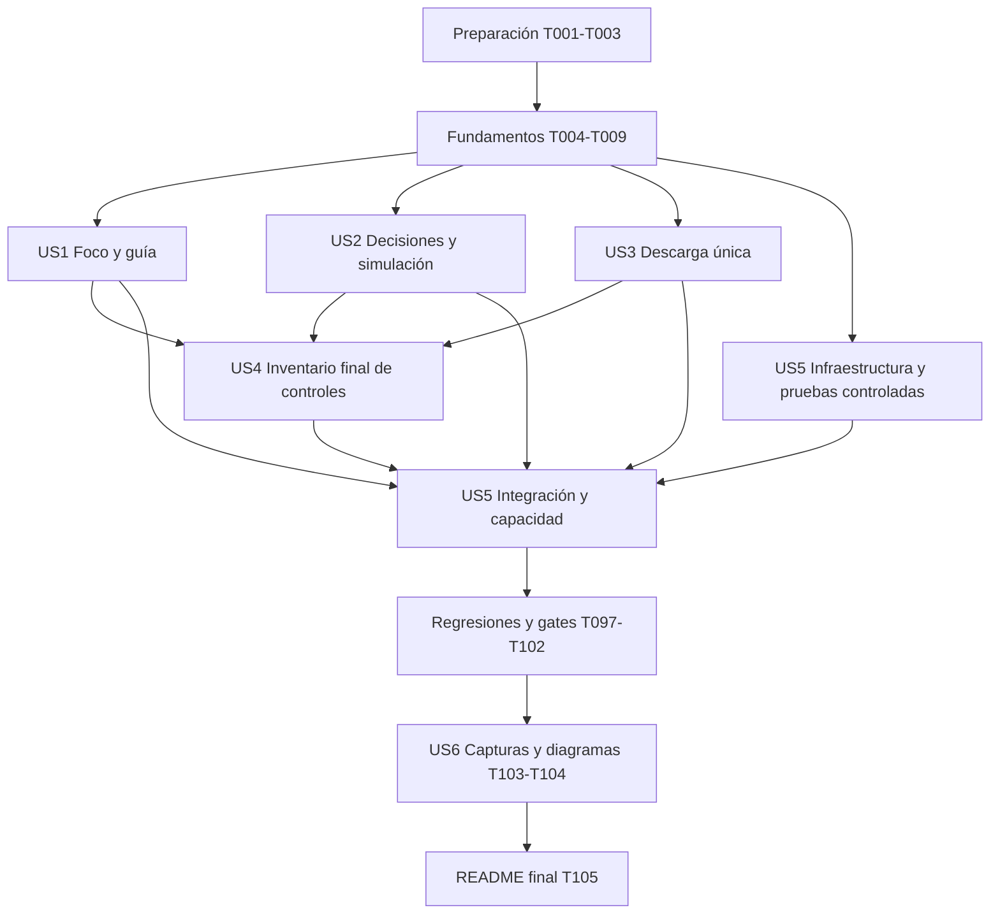

# Tasks: Flujo sencillo y demo pública independiente

**Input**: [spec.md](spec.md), [plan.md](plan.md), [research.md](research.md), [data-model.md](data-model.md), [contrato UI](contracts/ui.md), [contrato API](contracts/api.md), [contrato de despliegue](contracts/deployment.md) y [quickstart.md](quickstart.md).

**Rama**: `codex/005-simplificar-flujo-vercel` · **Fecha**: 2026-11-08 · **Estado**: implementación en curso; consultar casillas y docs/verification-005.md para la evidencia real.

**Organización**: historias en prioridad P1 → P2 → P3. Se adelanta el cierre transversal a US6 para cumplir la petición expresa: README es el último trabajo funcional, después de verificar el producto y capturar sus pantallas finales. La entrega no provisiona ni publica servicios.

## Formato y reglas de ejecución

- Cada casilla es una tarea ejecutable; `[USn]` identifica la historia de la especificación. `[P]` significa que puede ejecutarse en paralelo con las tareas indicadas en la sección de dependencias, una vez satisfechos sus prerrequisitos; no autoriza escrituras concurrentes sobre los mismos archivos.
- Todas las rutas de tareas son relativas a la raíz del repositorio. Las rutas que aún no existen son archivos por crear. Extender pruebas existentes cuando ya cubran el comportamiento; no duplicarlas solo para aumentar cobertura nominal.
- La especificación exige pruebas en sus escenarios y SC-001–010; el plan pide empezar por contratos/casos que fallen por la ausencia de la nueva conducta, no por un entorno roto. Registrar el fallo pertinente y después el resultado al implementar.
- Mantener Angular/Node/ANTLR JavaScript/Kahn, cantidades exactas, originales EBA y perfiles existentes. Condicionales, texto, fechas y desigualdades solo validan. Seleccionar o simular nunca equivale a aceptar la aplicación.
- No tocar el servidor del usuario en 3340. El arnés usa 3350–3354 solo tras comprobar propiedad/disponibilidad; no elimina ni cierra recursos ajenos. Nuevos scripts, dependencias y archivos de producto se crean en implementación, no al generar esta lista.
- Cada incremento terminado se registra en un commit acotado con sus comprobaciones. Mantener `docs/verification-005.md` como evidencia de implementación; no reescribir los hallazgos previos de `evidence.md` como si fueran resultados nuevos. No cerrar SC-010 de 004 con evidencia de 005.
- Receipt-driven development permanece `disabled/unmanaged`. Estas tareas no habilitan revisiones automáticas. Las cuentas, credenciales, compras y publicación requieren un entorno autorizado posterior; su ausencia no exime de las pruebas locales obligatorias.

## Fase 1: Preparación compartida

**Objetivo**: fijar el punto de partida y los casos verificables sin cambiar el alcance.

- [X] T001 Registrar rama/commit inicial, toolchain, hashes de fuentes y matriz de evidencia pendiente por FR/SC en `docs/verification-005.md`; contrastar los comandos existentes de `package.json` con `specs/005-simplificar-flujo-vercel/quickstart.md`, sin atribuir resultados de 004 a 005.
- [X] T002 [P] Crear `docs/controls-005.md` a partir de `specs/005-simplificar-flujo-vercel/contracts/ui.md`: identificar los 17 tipos de selectores, 11 desplegables y casillas/radios/toggles adicionales por componente, decisión prevista, casos cero/una/varias opciones, teclado y futura evidencia; no marcar controles comprobados todavía.
- [X] T003 [P] Preparar fixtures sintéticos reutilizables en `tests/helpers/iteration005-fixtures.ts` y `tests/e2e/iteration005-helpers.ts`: dos lados elegibles, único destino con colisión, 51 productores/decisiones, cero candidatos, base antigua, versiones 1/6 y valor individual grande; reutilizar originales/manifiestos existentes sin modificarlos.

## Fase 2: Fundamentos locales comunes

**Objetivo**: disponer de identidad de datos, contratos y puntos de extensión antes de las historias. No se condiciona la mejora local a contratar ni montar proveedores.

- [X] T004 Escribir los casos de identidad de base y compatibilidad en `tests/integration/validation-basis.spec.ts`: importar/aplicar cambia base, configurar la conserva, histórico ajeno/incompleto no es compatible y exportar resultados exige la versión exacta aunque comparta base; cubrir fixtures legados locales.
- [X] T005 Introducir `validationBasisId` y los esquemas/DTO cerrados asociados en `packages/contracts/src/common.ts`, `packages/contracts/src/common.schemas.ts` y `packages/contracts/src/validation.ts`, exportados desde `packages/contracts/src/index.ts`; preservar literalmente «cambia con importación/aplicación, se conserva al cambiar solo direcciones» y compatibilidad explícita local.
- [X] T006 Implementar la identidad inmutable y su propagación en `apps/api/src/session/workspace-store.ts`, `apps/api/src/validation/validation-service.ts`, `apps/api/src/recalculation/directions-service.ts` y `apps/api/src/recalculation/application-service.ts`; asignarla al publicar importación/aplicación y conservarla en configuración, sin deducirla de `selectedRunId` ni reinterpretar el motor; pasar T004.
- [X] T007 Extraer puertos de repositorio, objetos y despacho en `apps/api/src/ports/workspace-repository.ts`, `apps/api/src/ports/object-store.ts` y `apps/api/src/ports/job-dispatcher.ts`, con adaptadores locales en `apps/api/src/local/local-adapters.ts` y composición en `apps/api/src/app.ts`; conservar rutas locales y resultados observables, sin crear una dependencia de PostgreSQL para usar el modo local.
- [X] T008 Extender recibos y recuperación locales en `apps/api/src/session/idempotency-store.ts`, `apps/api/src/routes/operations.ts` y `tests/contract/operation-receipts.spec.ts`: fingerprint por propietario/método/ruta/cuerpo/base y consulta autorizada; cumplir «Idempotencia comprueba el recibo anterior **antes** de rechazar una base actualmente antigua; misma clave con fingerprint distinto es conflicto».
- [X] T009 [P] Definir contratos compartidos de intención, proyección compacta, sesión y transferencia en `packages/contracts/src/download.ts`, `packages/contracts/src/compact.ts`, `packages/contracts/src/demo-session.ts` y `packages/contracts/src/transfers.ts`, sus exports en `packages/contracts/src/index.ts` y casos cerrados en `tests/contract/iteration005-schemas.spec.ts`; identidades del servidor siempre vinculadas a sesión/conjunto, `runId` solo cuando corresponda, valores grandes por descriptor y sin URLs de proveedor. Los límites numéricos quedan vinculados a T057/T077/T082.

**Checkpoint**: contratos compilables, base y recibos verificados; historias locales pueden avanzar sin servicios externos. Los futuros adaptadores alojados no cambian la semántica del motor.

## Fase 3: US1 — Reconocer la etapa y continuar sin adornos incorrectos (P1, MVP)

**Objetivo**: foco útil, halo alrededor del botón completo y tres hitos correctos.

**Prueba independiente**: ratón → teclado en 320/390/1440 px; comprobar títulos, `summary`, errores, geometría, 4,5 s y alternativas estáticas. Carga → Validar, validación completa de base vigente → Recalcular, aplicación → Descargar; ningún histórico/fallo avanza. FR-001–004; SC-001.

- [X] T010 [P] [US1] Añadir casos de eventos de validación sin nueva versión y exclusión de bases antiguas/incompletas en `apps/web/src/app/workspace/workspace-view.store.spec.ts`, conservando deduplicación de anuncios y distinción entre etapa actual/recomendada.
- [X] T011 [P] [US1] Reproducir el contorno de `summary` y añadir geometría/modalidades en `tests/e2e/workflow-guidance.spec.ts`: caja/radio completos, botón estable, ausencia de desplazamiento o captura de eventos, ratón/Tab/Enter, movimiento reducido y colores forzados a las tres anchuras; no asumir que `summary` tiene la misma causa que el título.
- [X] T012 [US1] Corregir estilos de foco acotados en `apps/web/src/styles.scss` y, si lo exige T011, `apps/web/src/app/core/stage-title.directive.ts`; conservar `StageFocus`, `tabindex=-1`, foco visible de teclado/formularios/errores y orientación programática; no usar `blur()` ni eliminar outlines globalmente.
- [X] T013 [US1] Mover el halo a un hermano del botón dentro de envoltorio propio en `apps/web/src/app/workspace/workspace-shell.component.html` y `apps/web/src/app/workspace/workspace-shell.component.scss`, ajustando la disposición responsive de `apps/web/src/styles.scss`; conservar radio/caja, 4,5 s y alternativa estática, sin clases privadas de Material ni texto «Siguiente paso».
- [X] T014 [US1] Modelar los hitos confirmados por base/operación en `apps/web/src/app/workspace/workspace-view.store.ts`: validación completa no finge publicación de versión; configuración no dispara otro salto; impedir recomendaciones por cancelación/fallo o por resultados de otra base.
- [X] T015 [US1] Conectar los hitos a resultados confirmados en `apps/web/src/app/workspace/workspace-shell.component.ts`, `apps/web/src/app/validation/results.store.ts` y `apps/web/src/app/core/session.store.ts`; mantener anuncios y botón estable y no esperar a que se renderice la configuración de destinos para presentar una validación.
- [X] T016 [US1] Ejecutar T010/T011 y las pruebas afectadas de foco/shell, y registrar evidencia SC-001, geometría y límites en `docs/verification-005.md`; no marcar la prueba visual por comprobar únicamente duración o existencia de clases CSS.

## Fase 4: US2 — Elegir solo las celdas que requieren una decisión (P1)

**Objetivo**: destinos al comienzo de Recalcular, pendientes globales y una simulación atómica recuperable.

**Prueba independiente**: casos único/ambos lados/conflictos/cero; diez entradas o recargas sin versiones, configuración sin revalidar datos, decisiones en páginas posteriores y caída antes/después del commit. FR-005–009; SC-002, regresión SC-009.

- [X] T017 [P] [US2] Añadir contratos de `recalculation-state`, ámbito `pending|resolved|all`, preparación y operación compuesta en `tests/contract/recalculation-operations.spec.ts`: bases/revisiones, pendientes no omitidos, IDs reservados frente a publicados y recuperación por clave.
- [X] T018 [P] [US2] Añadir fallos de publicación, recibo perdido, configuración equivalente y diez preparaciones repetidas en `tests/integration/recalculation-operation-lifecycle.spec.ts`; comprobar que éxito publica versión/configuración, preview, selección y recibo juntos y que fallo/cancelación conserva datos, versión y borrador.
- [X] T019 [P] [US2] Añadir recorrido de entrada directa, 51 decisiones, elección/omisión preservada, guard de salida y cero candidatos en `tests/e2e/recalculation-decisions.spec.ts`; verificar simulación sin preparar/guardar manualmente y consentimiento invalidado al cambiar selección.
- [X] T020 [US2] Definir DTO/esquemas de estado, revisión y operación compuesta en `packages/contracts/src/recalculation-state.ts`, `packages/contracts/src/recalculation-operation.ts`, `packages/contracts/src/direction-review.ts` y `packages/contracts/src/index.ts`, ampliando los tipos de trabajo en `packages/contracts/src/common.ts`; reflejar `needs_validation|no_candidates|preparation_required|pending|ready` y entrada cerrada con base/basis/run/review/revisión, sin confundir `reservedPreviewId` con resultado publicado.
- [X] T021 [US2] Extender el índice puro de decisiones en `packages/engine/src/recalculation/direction-review.ts`, `packages/engine/src/recalculation/direction-review-index.ts` y `packages/engine/src/recalculation/configuration.ts`: inequívocos automáticos salvo omisión vigente, dos lados pendientes y productor competidor pendiente; «Conserva elegidos/omitidos; pendiente no equivale a omisión».
- [X] T022 [US2] Crear `apps/api/src/recalculation/recalculation-state-service.ts` y `apps/api/src/routes/recalculation-state.ts`: resolver ejecución completa por base actual en servidor, contadores globales y estado recuperable sin escribir en GET ni usar el histórico seleccionado por Angular.
- [X] T023 [US2] Adaptar `apps/api/src/recalculation/direction-review-service.ts` y `apps/api/src/routes/direction-reviews.ts` para crear/reusar borrador idempotente y paginar el ámbito en servidor antes de serializar; conservar revisiones, mutationId, elecciones, omisiones y grupos fuera de la primera página, sin versiones por navegación ni bypass de pendientes.
- [X] T024 [US2] Crear `apps/api/src/workers/recalculation-operation.worker.ts` y extender `apps/api/src/workers/protocol.ts` para construir snapshot virtual de configuración y ejecutar preview en un único job; conservar cálculo/Kahn y «configuración igual reutiliza versión», sin publicar la configuración antes de que la simulación termine.
- [X] T025 [US2] Implementar aceptación y publicación local de la operación en `apps/api/src/recalculation/recalculation-operation-service.ts`, `apps/api/src/routes/recalculation-operations.ts` y `apps/api/src/app.ts`; reservar IDs/recibo, rechazar pendientes/base/revisión inválidas y publicar configuración+preview+selección+terminal una sola vez, compatible con los puertos de T007 y recibos T008.
- [X] T026 [US2] Adaptar `apps/web/src/app/recalculation/directions.store.ts` y `apps/web/src/app/core/api-client.ts` a estado actual, preparación automática recuperable y pendientes globales; distinguir preparar borrador de acción manual significativa, preservar ediciones al filtrar/contexto/página y descartar respuestas de otra base.
- [X] T027 [US2] Trasladar `DirectionsComponent` desde `apps/web/src/app/validation/validation-page.component.ts` y `apps/web/src/app/validation/validation-page.component.html` al comienzo de `apps/web/src/app/recalculation/preview-page.component.ts` y `apps/web/src/app/recalculation/preview-page.component.html`; usar el título exacto «Elegir qué celdas recalcular» y no enlazar la ejecución histórica de Validar a esta preparación.
- [X] T028 [US2] Simplificar `apps/web/src/app/recalculation/directions.component.ts` y `apps/web/src/app/recalculation/directions.component.html`: solo pendientes inicialmente, resumen y revisión deliberada de resueltos, elección/omisión explícita y estados sin validación/sin candidatos; retirar preparar/guardar y aceptar pendientes como si estuvieran resueltos, conservando editor de conflictos accesible.
- [X] T029 [US2] Conectar «Simular recálculos» a una operación recuperable en `apps/web/src/app/recalculation/preview.store.ts` y crear `apps/web/src/app/core/operation-attempt.store.ts`; persistir solo IDs/clave/ETag/revisión mínimos antes del envío, recuperar recibo tras recarga y reutilizar el intento exacto ante incertidumbre, sin encadenar guardar+simular desde Angular.
- [X] T030 [US2] Extender las guardas de navegación/cambio de base/editor en `apps/web/src/app/workspace/workspace-shell.component.ts` y `apps/web/src/app/recalculation/directions.store.ts`; no perder cambios sin confirmar ni sobrescribir el editor por una respuesta tardía; permitir ir a Validar o Descargar según el estado real.
- [X] T031 [US2] Integrar la base efectiva y revisión de selección con `apps/api/src/recalculation/proposal-selection-service.ts`, `apps/api/src/recalculation/application-service.ts` y `apps/web/src/app/recalculation/apply.store.ts`; conservar preselección 004, dependencias fuera de página, CAS, confirmación explícita invalidable y aplicación+revalidación atómicas, sin autoaplicar.
- [X] T032 [US2] Adaptar los escenarios anteriores en `tests/e2e/conflict-decisions.spec.ts`, `tests/e2e/bulk-selection.spec.ts`, `tests/integration/direction-review-lifecycle.spec.ts` y `tests/integration/validation-only-guards.spec.ts` al nuevo punto de entrada; mantener los casos reales de omisiones, ciclos, ramas independientes y reglas solo de validación.
- [X] T033 [US2] Ejecutar T017–T019/T032 y pruebas afectadas de stores/componentes; registrar SC-002 y atomicidad/recuperación en `docs/verification-005.md`, incluyendo diez reentradas sin versiones y ninguna validación adicional por cambiar solo configuración.

## Fase 5: US3 — Descargar exactamente el resultado elegido (P1)

**Objetivo**: una intención estable y un único botón en Descargar, sin descargas del conjunto desde otras etapas.

**Prueba independiente**: todas las clases de contenido, versión 1 frente a artefacto 6, histórico voluntario, opciones tardías, aceptación incierta, recarga, cancelación y fallo de transferencia; DOM = store = resumen = petición = archivo. FR-010–013; SC-003/004.

- [X] T034 [P] [US3] Añadir compatibilidad estricta de versión/ejecución e idempotencia a `tests/contract/download-intent.spec.ts`, extendiendo los casos reales de `tests/contract/results-export.spec.ts`; compartir base no autoriza exportar resultados de otra versión.
- [X] T035 [P] [US3] Añadir la máquina de estados, respuestas fuera de orden y recuperación de intento en `apps/web/src/app/recalculation/export.store.spec.ts`, incluyendo bloqueo solo durante aceptación incierta, cambio después de conocer job y reintento de transferencia sin regenerar ZIP.
- [X] T036 [P] [US3] Reproducir selector 1/resumen 6 y añadir todos los estados del único botón en `tests/e2e/download-intent.spec.ts`; comprobar opciones que llegan tarde, histórico después de aplicar y los bytes del archivo, sin asumir que comprobar solo señales acredita selección visible.
- [X] T037 [US3] Vincular intención, resumen, trabajo y artefacto en `apps/api/src/routes/exports.ts`, `packages/contracts/src/download.ts` y `packages/contracts/src/export-summary.ts`; exigir `run.versionId === intent.versionId`, preservar contenidos y guardas existentes, y devolver identidad/fingerprint recuperables con el mismo recibo.
- [X] T038 [US3] Refactorizar `apps/web/src/app/recalculation/export.store.ts` con `DownloadIntent` y estados `idle → accepting → preparing → ready → transferring → ready`, más `uncertain|failed|cancelled|expired`; una intención distinta no es el mismo trabajo y un terminal ajeno nunca cambia elección ni descarga automáticamente.
- [X] T039 [US3] Integrar el intento mínimo de exportación con `apps/web/src/app/core/operation-attempt.store.ts` y `apps/web/src/app/core/session.store.ts`: conservar intención, clave, ETag y IDs por namespace de conexión; misma petición incierta recupera recibo antes de consultar base, fallo terminal necesita nueva acción/clave y el histórico elegido no se fuerza al vigente.
- [X] T040 [US3] Rehacer los controles de `apps/web/src/app/recalculation/exports.component.ts` y `apps/web/src/app/recalculation/exports.component.html` con Forms públicas/IDs string, lectura para una opción, recuperación para cero y un único botón preparar/descargar/reintentar; retirar atajo de informes aplicados y repetir paquete, mantener Cancelar separado y resumen ligado a la intención.
- [X] T041 [US3] Sustituir la descarga de `apps/web/src/app/validation/results-export.component.ts` por navegación contextual a Descargar mediante `apps/web/src/app/workspace/workspace-view.store.ts`, y retirar descarga e inyección de exportación de `apps/web/src/app/recalculation/comparison.component.ts` y `apps/web/src/app/recalculation/comparison.component.html`; las demos/plantillas de Cargar continúan descargables allí.
- [X] T042 [US3] Incorporar abortado/cancelación y reintento del artefacto existente en `apps/web/src/app/recalculation/export.store.ts` y `apps/web/src/app/core/api-client.ts`; la transferencia solo comienza si intención/sesión siguen vigentes y nunca crea otra preparación por un fallo de recepción; permitir sustituir transporte local por partes en US5 sin cambiar la máquina de estados.
- [X] T043 [US3] Actualizar `tests/e2e/apply-export.spec.ts`, `tests/e2e/visual-roundtrip.spec.ts` y `apps/web/src/app/recalculation/exports.component.spec.ts` a la acción única, conservando contenido/export-reimport y cancelación; eliminar expectativas de los botones retirados sin borrar casos de negocio.
- [X] T044 [US3] Ejecutar T034–T036/T043 y casos afectados; registrar SC-003/004 y la causa reproducida o el límite observado del selector en `docs/verification-005.md`, con evidencia de coincidencia entre selección visible y archivo real.

## Fase 6: US4 — Encontrar controles que aporten una elección útil (P2)

**Objetivo**: completar el inventario del analista sin ocultar decisiones, errores, exclusiones, importes ni origen.

**Prueba independiente**: todos los tipos de `docs/controls-005.md`, teclado y pantalla estrecha, cero/una/varias alternativas, detalles con/sin contenido e históricos. FR-014–017; SC-005.

- [X] T045 [P] [US4] Añadir matriz de comportamiento para los controles conservados y eliminados en `tests/e2e/analyst-controls.spec.ts`, reutilizando escenarios de `tests/e2e/useful-information.spec.ts`; cubrir utilidad observable y teclado, no solo número de elementos.
- [X] T046 [P] [US4] Añadir casos de explicación numérica real frente a texto/fecha/sin operandos en `apps/web/src/app/shared/calculation-detail.component.spec.ts`, manteniendo localizadores, ausencia frente a cero y procedencia útil.
- [X] T047 [US4] Simplificar controles de Cargar en `apps/web/src/app/import/import-page.component.ts` y `apps/web/src/app/import/import-page.component.html`: retirar detalle genérico de nulos, lectura para opción única y conservar elección real de demo/perfil/contexto/tipo/escala/presentación/filtro, exclusiones y regla; nunca inferir escala o presentación por conveniencia visual.
- [X] T048 [US4] Resolver lectura frente a selector de contexto/ejecución/simulación y sus estados cero en `apps/web/src/app/workspace/workspace-shell.component.html`, `apps/web/src/app/validation/validation-page.component.html` y `apps/web/src/app/recalculation/preview-page.component.html`; mantener foco al desaparecer un selector y retirar «Formato de resultados» de Validar, dejando solo la explicación necesaria en Descargar.
- [X] T049 [US4] Condicionar el detalle numérico a contenido real en `apps/web/src/app/shared/calculation-detail.component.ts` y `apps/web/src/app/shared/calculation-detail.component.html`; conservar regla, diagnóstico, antes→después, origen y lectura de valores grandes, sin desplegable vacío ni panel técnico genérico.
- [X] T050 [US4] Convertir el resumen siempre abierto en contenido normal en `apps/web/src/app/recalculation/comparison.component.html` y eliminar «Volver» duplicado en `apps/web/src/app/recalculation/preview-page.component.html`; conservar revisión de selección paginada, antecedentes, toggles útiles, productor/omisión y confirmación de aplicación solo cuando corresponda.
- [X] T051 [US4] Ajustar la comprobación de informes/contexto/exclusiones a la intención elegida en `apps/web/src/app/recalculation/exports-visual.spec.ts` y `tests/e2e/analyst-controls.spec.ts`; no presentar hojas solo preservadas como validadas y comprobar que decisiones/errores necesarios no quedan ocultos tras detalles cerrados.
- [X] T052 [US4] Ejecutar T045/T046/T051 y escenarios afectados; completar cada fila de `docs/controls-005.md` con decisión final, caso/evidencia y resultado, registrando SC-005 en `docs/verification-005.md`; ningún tipo inventariado queda sin comprobación ni se considera útil solo por existir.

## Fase 7: US5 — Probar la demo sin compartir datos con otros visitantes (P2)

**Objetivo**: sesiones privadas recuperables, jobs durables, objetos privados y preparación reproducible de dos proyectos Vercel sobre el baseline gratuito elegido. Mantener el modo local.

**Prueba independiente**: PostgreSQL 17 real aislado, dos instancias API, dos orígenes y dos visitantes, cola/objetos controlados con fallos. Recorrer carga→validación→simulación→aplicación→descarga, negar referencias cruzadas, recuperar respuestas perdidas, revocar/limpiar sin navegador y medir los máximos del contrato. La prueba controlada no acredita funcionamiento real de Neon/QStash/Blob/Vercel. FR-018–026; SC-006–008.

### Preparación y pruebas de US5

- [X] T053 [US5] Fijar `pg` 8.23.1, `@types/pg` 8.23.1, `@vercel/blob` 2.8.2 y `@upstash/qstash` 2.12.1 en `apps/api/package.json` y `package-lock.json`; mantener el resto del toolchain exacto y añadir configuración validada en `apps/api/src/hosted/config.ts` para modos local/hosted/hosted-test, URLs normalizadas HTTPS salvo loopback, clave de cursor de 32 bytes y cuotas de `specs/005-simplificar-flujo-vercel/contracts/deployment.md`.
- [X] T054 [US5] Crear arnés de PostgreSQL 17 real con esquema aislado, dos API, reloj/barreras y adaptadores controlados en `tests/helpers/hosted-harness.ts`, `tests/helpers/controlled-queue.ts`, `tests/helpers/controlled-objects.ts` y `scripts/test-hosted.mjs`; añadir `test:hosted` en `package.json` y configuración en `vitest.config.ts`. Verificar daemon/TEST_DATABASE_URL, propiedad de procesos/puertos y cleanup propio; no sustituir SQL por un mock ni declarar PASS si falta entorno.
- [X] T055 [P] [US5] Añadir contratos de sesión/CORS en `tests/contract/hosted-session.spec.ts` y `tests/contract/hosted-cors.spec.ts`: pareja token/nonce, aceptación perdida, token/nonce cruzados, no resurrección, owner404, preflight, cabeceras expuestas, rechazo de origen y CORS de errores de aplicación.
- [X] T056 [P] [US5] Añadir integración SQL con fallos antes/después de aceptar, enviar, reclamar, escribir objetos, publicar y responder en `tests/integration/hosted-jobs.spec.ts` y `tests/integration/hosted-publication.spec.ts`; comprobar duplicados concurrentes, fence antiguo, permisos huérfanos, recibo antes de base y ninguna aplicación/configuración parcial.
- [ ] T057 [P] [US5] Añadir pruebas de fragmentos y proyecciones en `tests/contract/hosted-transfers.spec.ts`, `tests/contract/hosted-payloads.spec.ts` y `tests/integration/hosted-transfers.spec.ts`: JSON UTF-8 ≤ 1 MiB, página ≤ 50, binario ≤ 3 MiB, archivo válido > 4,5 MB, máximos+1, hashes, reintentos, owner, valor individual grande y manifestación solo tras todas las partes.
- [X] T058 [P] [US5] Añadir reloj controlado y carreras de revocación/cuotas/cleanup en `tests/integration/hosted-lifecycle.spec.ts` y `tests/integration/hosted-quotas.spec.ts`: 60 min/24 h, acciones que no renuevan, caída del proveedor, presupuesto de mantenimiento reservado, objetos inciertos y barrido sin pestañas, con limpieza ≤ 24 h.
- [ ] T059 [P] [US5] Crear `tests/e2e/hosted-journey.spec.ts`, `tests/e2e/hosted.config.ts` y `scripts/test-e2e-hosted.mjs`, registrando `test:e2e:hosted` en `package.json`: dos contextos de navegador, dos orígenes, balanceo controlado entre instancias con el mismo perfil/URL público, navegación directa/recarga, errores, cierre y recuperación, sin compartir sessionStorage entre visitantes.

### Autoridad, identidad y almacenamiento

- [X] T060 [US5] Crear migración versionada `apps/api/src/hosted/migrations/001-demo.sql` y cliente `apps/api/src/hosted/database.ts` con todas las entidades de `specs/005-simplificar-flujo-vercel/data-model.md`, ownership/índices/uniques/checks; incluir literalmente «`tokenHash` único y `creationNonceHash` único», «un conjunto activo por sesión» y «Razón import/configuration/application; máximo 20 snapshots retenidos». Pool ≤ 2, TLS verificado y un cliente BEGIN→COMMIT/ROLLBACK con release, sin transacciones abiertas durante worker/red larga.
- [ ] T061 [US5] Implementar `apps/api/src/hosted/postgres-repository.ts` para bases/versiones/runs/reviews/previews/selecciones/operaciones/recibos y referencias; consultas siempre owner-qualified, CAS/revisiones y estados confirmados entre instancias. Índices pequeños, nunca una fila con la sesión completa; conservar campos/estados del modelo y expiración de revisiones/artefactos.
- [X] T062 [US5] Implementar codec/manifiestos canónicos en `apps/api/src/hosted/canonical-codec.ts`, adaptando `apps/api/src/session/canonical-state.ts` y `apps/api/src/session/retained-size.ts`: «Mantener cadenas exactas de numerador/denominador, unidades, precisión, ausencias, orden y fuentes; no transformar cantidades a `number` ni persistir Map/Set/Date/BigInt/ciclos». Versionar codec/hash, rehidratar estructuras de ejecución separadamente y compartir bloques solo intrasesión.
- [X] T063 [US5] Implementar reservas y ledger transaccionales en `apps/api/src/hosted/quota-ledger.ts`: «Estado retenido ≤ 512 MiB y archivos ≤ 512 MiB son presupuestos separados»; 4 sesiones/10 altas al día UTC, 30 jobs/día y 120/30 días móviles, 8 en cola, Blob global 768 MiB, SQL 512 MiB con índices. Aplicar presupuestos Blob 1600 avanzadas/8000 simples/8 GiB y QStash 700 públicas+100 mantenimiento/día, reservando 200/1000/1 GiB Blob para mantenimiento; contabilizar intentos, provisionales, huérfanos y conciliación antes de liberar reservas, sin upgrades ni recortes ocultos.
- [X] T064 [US5] Implementar `apps/api/src/hosted/blob-object-store.ts` y `apps/api/src/hosted/object-ledger.ts` sobre T062/T063: claves privadas del servidor, bloques inmutables/refCount compartidos por sesión, reserva antes de red y autorización al registrar/publicar; objetos inciertos siguen contabilizados hasta reconciliar. Nunca devolver SDK/token/URL/clave Blob al cliente ni deduplicar entre visitantes.
- [X] T065 [US5] Implementar `apps/api/src/hosted/session-service.ts`, `apps/api/src/routes/hosted-sessions.ts` y `apps/api/src/routes/hosted-bootstrap.ts`: candidato de 32 bytes+nonce generados por navegador, hashes únicos vinculados, IDs servidor, 201/200 mismo par, 409 par divergente y 410 cerrado/caducado. Aplicar «Máximo inactivo 60 min/absoluto 24 h; polling/GET/recarga/partes no renuevan»; GET no renueva y DELETE revoca transaccionalmente antes de responder.
- [ ] T066 [US5] Resolver contexto por petición en `apps/api/src/plugins/hosted-session.ts` y `apps/api/src/app.ts`, migrando todos los consumidores de `app.ce.store`/`app.ce.files` en `apps/api/src/routes/workspaces.ts`, `apps/api/src/routes/history.ts`, `apps/api/src/routes/rules.ts` y las rutas de carga/resultados/recálculo/exportación indicadas en T078/T084; consulta DB viva en cada acceso/commit, sin caché de vigencia, sesión global o IDs como permisos. Recursos ajenos/inexistentes404 indistinguibles; sesión inválida/caducada401/410.
- [ ] T067 [US5] Implementar `apps/api/src/plugins/cors.ts` y `apps/api/src/plugins/hosted-body-limits.ts`: allowlist exacta producción/preview, métodos GET/POST/PATCH/PUT/DELETE/OPTIONS según rutas, Content-Type/X-CE-Session/If-Match/Idempotency-Key/X-CE-Part-SHA256, exposición ETag/Content-Disposition/hash, Vary y no-store; sin cookies/Allow-Credentials. OPTIONS valida sin bearer, onRequest autentica y reserva antes de buffer privado; parsers miden bytes reales JSON1 MiB/binario3 MiB sin confiar solo en Content-Length.
- [ ] T068 [US5] Crear `apps/web/src/app/core/connection-config.ts` y `apps/web/src/app/core/session-persistence.ts`, adaptando `apps/web/src/app/core/api-client.ts`: API_BASE_URL es origen sin `/api/v1`, vacío local; normalizar y añadir el prefijo una vez. Namespace por origen frontend/API/perfil y WebCrypto antes de POST, sin credenciales proveedor; «No guarda Excel, reglas, hechos, blobs, respuestas de negocio ni secretos de proveedor».
- [ ] T069 [US5] Integrar sesión anónima y recuperación en `apps/web/src/app/core/session.store.ts` y `apps/web/src/app/core/operation-attempt.store.ts`: recarga misma pestaña conserva token/nonce/IDs mínimos, creación perdida repite mismo par, cierre/caducidad borra credenciales e intentos y no crea otra sesión silenciosamente. Polling activo5 s con retroceso10 s, ninguno en reposo; borrador automático, foco, GET, fragmentos y reintentos no renuevan actividad.

### Trabajos durables y publicación

- [X] T070 [US5] Implementar `apps/api/src/hosted/job-acceptance.ts` y `apps/api/src/hosted/outbox.ts`, adaptando `apps/api/src/routes/operations.ts`: transacción sesión/base/cuotas+job/IDs reservados+recibo/outbox; recuperar mismo fingerprint antes de rechazar base antigua. Esperar envío, 202 solo confirmado y 503 `JOB_DISPATCH_UNCERTAIN` con IDs recuperables si incierto; retry republica el mismo job, nunca otro.
- [X] T071 [US5] Implementar `apps/api/src/hosted/qstash-dispatcher.ts` y `apps/api/src/routes/internal-jobs.ts`: mensaje de referencias pequeñas, firma actual/siguiente sobre raw body y URL pública exacta antes de parsear, autenticación interna independiente del bearer; timeout120 s, máximo3 reintentos con backoff dentro de TTL10 min y flow-control1 suplementario al permiso SQL.
- [X] T072 [US5] Implementar claim/lease/fence en `apps/api/src/hosted/job-coordinator.ts`: «Un CPU global y por conjunto; nunca reasignar un permiso de proceso posiblemente vivo antes de 120 s desde claim». Añadir límite por instancia1, cola10 min, deadline60 s desde primer claim, duplicado sin segundo worker y ningún reinicio del plazo de un intento iniciado perdido.
- [ ] T073 [US5] Crear ejecutor esperado `apps/api/src/hosted/worker-runner.ts` y `apps/api/src/workers/hosted-operation-worker.ts`, adaptando `apps/api/src/workers/protocol.ts`, `apps/api/src/jobs/job-manager.ts` y `apps/api/src/jobs/preparation-manager.ts` a comandos explícitos para import/inspect/seal/prepare-directions/commit-directions/validate/recalculation-operation/preview/select-proposals/apply/export donde estén expuestos. «Sin closures ni objetos de proceso persistidos»; IPC compacto, hidratar solo entradas en worker, heap viejo256 MiB y deadline60 s incluyendo I/O/publicación, sin fire-and-forget/waitUntil como durabilidad.
- [ ] T074 [US5] Implementar `apps/api/src/hosted/publication.ts` y conectar servicios de T025/T031/T037: después de escribir objetos provisionales, transacción corta verifica sesión/base/ETag/fence/cancel/deadline y publica punteros/versión/recibo/job terminal juntos. «Publicación inicial de preview+selección atómica»; configuración igual reutiliza versión; aplicación incluye revalidación y originales, fallo no publica prefijos y deja residuos reconciliables.
- [X] T075 [US5] Conectar estado/cancelación de `apps/api/src/routes/jobs.ts` con `apps/api/src/hosted/job-coordinator.ts` y `apps/api/src/hosted/worker-runner.ts`: señal persistida comprobada cada750–1000 ms, SharedArrayBuffer/terminación, estado expirado inmediato por GET/CAS y callback terminal idempotente; responder2xx solo después de esperar ejecución y publicación durable, nunca permitir publicación de fence antiguo.
- [X] T076 [US5] Implementar `apps/api/src/hosted/maintenance.ts` y `apps/api/src/routes/internal-maintenance.ts`: sweep horario firmado con lease/lotes, outbox, cola/deadlines, permisos tras techo seguro, sesiones, reservas y objetos sin referencia. «Persiste aunque sesión esté revocada; no requiere token del visitante»; limpieza≤24 h sin navegador, presupuesto propio incluso con admisión cerrada, sin enumerar todo Blob en cada tick, detectar atasco antes18 h y nunca ejecutar cola vencida.

### Transferencias privadas y consultas acotadas

- [X] T077 [US5] Crear lotes/partes/consulta/cancelación en `apps/api/src/storage/upload-batches.ts` y `apps/api/src/routes/upload-batches.ts`: «Un catálogo+ 1–20 informes, total ≤ 50 MiB», «Cada entrada ≤ 10 MiB; nunca ruta del cliente» y «Único(owner, recurso, index); mismo hash/tamaño reintenta, distinto 409». Parte≤3 MiB, nombres sanitizados/IDs servidor, reserva previa, SHA real y segunda autorización antes de registrar, sin aceptar bytes posteriores a revocación.
- [ ] T078 [US5] Crear `apps/api/src/workers/seal-upload.worker.ts`, ampliar el tipo de trabajo correspondiente en `packages/contracts/src/common.ts` y conectar `uploadBatchId` en `apps/api/src/routes/import-inspections.ts`, `apps/api/src/routes/imports.ts` y `apps/api/src/import/import-inspection-service.ts`; «Sellar verifica continuidad, totalidad, hash completo y guardasZIP; nunca publicar un manifiesto parcial». Reconstruir en tmp acotado, expansión≤100 MiB y preflight existente sin ejecutar fórmulas/macros/enlaces; multipart excluyente y solo local. Requiere T070–T077, no declarar durable el sellado antes del coordinador.
- [X] T079 [US5] Implementar `apps/api/src/hosted/retained-sources.ts` y adaptar `apps/api/src/storage/session-files.ts` y `apps/api/src/export/visual-report-shared.ts`: promoción staging→original en la publicación de importación, originales FINREP/COREP retenidos mientras cualquier versión referencia; reconstruir solo lo necesario en tmp y verificar tamaño/SHA antes de `retainedSource`/`verifySource`, sin depender de staging de otra instancia.
- [X] T080 [US5] Implementar `apps/api/src/hosted/export-artifacts.ts`, manifiesto/partes en `apps/api/src/routes/exports.ts` y salida de `apps/api/src/workers/export.worker.ts`: «ZIP final ≤ 100 MiB real incluido overhead; máximo 34 partes», cada parte≤3 MiB. Publicar únicamente tras persistir/verificar todas; intención exacta de T037, guardas64 MiB/exportador y límites XLSX/lote conservados, reserva temporal200 MiB computada dentro del pico global; nunca URL externa o archivo completo por ruta hosted ordinaria.
- [X] T081 [US5] Implementar equivalentes locales de fragmentos/manifiestos en `apps/api/src/local/local-adapters.ts`, `apps/api/src/storage/upload-batches.ts` y `apps/api/src/routes/exports.ts`, conservando multipart y descarga legacy solo local; añadir paridad en `tests/integration/local-transfer-compatibility.spec.ts` para usar el mismo cliente sin proveedores.
- [ ] T082 [US5] Crear `apps/web/src/app/core/chunk-transfer.ts` y conectar `apps/web/src/app/import/import.store.ts`, `apps/web/src/app/recalculation/export.store.ts` y `apps/web/src/app/core/api-client.ts`: tamaños/hashes completos y por parte, orden/ensamblado, progreso/cancelación, reintento sin regenerar ZIP y reelección del mismo archivo tras recarga con verificación o descarte. No persistir bytes de negocio ni cambiar el único botón de T040.
- [X] T083 [US5] Crear índices/proyecciones y codec de cursor en `apps/api/src/hosted/query-repository.ts` y `apps/api/src/routes/pagination.ts`: «Cursor firmado vincula owner, recurso, base/revisión, filtro y última clave; máximo 50 filas y 1 MiB real por respuesta. Valor individual mayor se presenta por descriptor fragmentado, nunca truncado». Clave32 bytes compartida entre instancias; contar bytes UTF-8 reales y consultar índices/bloques necesarios, no hidratar toda sesión para recortarla.
- [ ] T084 [US5] Aplicar proyección compacta en `apps/api/src/routes/workspaces.ts`, `apps/api/src/routes/results.ts`, `apps/api/src/routes/rules.ts`, `apps/api/src/routes/history.ts`, `apps/api/src/routes/direction-reviews.ts`, `apps/api/src/routes/proposal-selections.ts` y `apps/api/src/routes/previews.ts`, creando `apps/api/src/routes/values.ts`: contextos y resúmenes sin arrays globales de IDs/grafo/lecturas y explicación paginada operands/reads/origins/diagnostics/descriptions; valores grandes por partes autorizadas, fuentes de ejecución retenida y variante legacy exclusivamente local.
- [ ] T085 [US5] Migrar consumidores a la misma proyección compacta en `apps/web/src/app/import/import.store.ts`, `apps/web/src/app/validation/results.store.ts`, `apps/web/src/app/recalculation/preview.store.ts`, `apps/web/src/app/recalculation/directions.store.ts`, `apps/web/src/app/core/session.store.ts`, `apps/web/src/app/shared/calculation-detail.component.ts` y `apps/web/src/app/core/api-client.ts`; cargar todas las páginas/partes solicitadas sin truncar, conservar selección/dependencias globales y diagnóstico/origen útil, sin interpretar límite de transporte como regla no soportada.
- [ ] T086 [US5] Añadir errores públicos y logs redactados en `packages/contracts/src/errors.ts` y `apps/api/src/hosted/operational-log.ts`, y avisos breves en `apps/web/src/app/workspace/workspace-shell.component.html` y `apps/web/src/app/core/session.store.ts`: demo sintética, aviso contextual10 min antes de vencer, cuotas/reintentos/recuperación comprensibles; sin detector ficticio de datos reales, banner técnico permanente, tokens/nonce/cuerpos privados en logs ni detalles de otro visitante.

### Empaquetado, operación y comprobación

- [ ] T087 [US5] Crear `apps/api/api/index.ts` y `apps/api/src/hosted-entry.ts`: composición hosted con proveedores/pools reutilizables sin identidad global, Fastify.ready antes de emitir request/response, sin listener ni serveWeb/bootstrap de token global. Enrutado conserva URL original para firma y separa autenticación `/api/v1` de `/internal`; probar arranque repetido sin estado de visitante reutilizado.
- [X] T088 [P] [US5] Crear `scripts/package-vercel-web.mjs` y `apps/web/vercel.json`, adaptar `apps/web/angular.json` y registrar `package:vercel:web` en `package.json`: raíz apps/web con acceso compartido, solo contratos+Angular, salida `apps/web/.vercel-dist/browser`, configuración pública sin secretos y fallback de rutas app que conserva404 de assets.
- [ ] T089 [US5] Crear `scripts/package-vercel-api.mjs` y `apps/api/vercel.json`, registrando `package:vercel:api` en `package.json`: raíz apps/api/preset null, Node24.x Fluid2 GB/1 CPU/maxDuration120 s, rewrites conservando URL, trazado de workers/parser/assets y paquetes compartidos. Build npm11.19.1, Java≥11, ANTLR4.13.2, sin generar parser durante peticiones; mantener pins locales y registrar patch real del proveedor si se verifica después.
- [ ] T090 [US5] Crear `scripts/test-package-linux.mjs` y registrar `test:package:linux` en `package.json`: verificar hashes JAR/gramáticas/originales y ocho generados reproducibles, construir ambos paquetes y ejecutar cada clase de job/demos en Linux aislado sin acceso al checkout vecino; acreditar resolución de imports dinámicos/workers/assets y ausencia de secretos frontend, no solo compilación.
- [ ] T091 [US5] Crear `scripts/test-capacity-hosted.mjs`, `tests/performance/hosted-capacity.spec.ts` y fixtures de volumen en `tests/helpers/hosted-capacity-fixtures.ts`, registrando `test:capacity:hosted` en `package.json`: baseline2 GB/1 CPU, RSS agregado≤1,6 GiB y tmp≤400 MiB, 20 snapshots compartidos, entradas10/50/100 MiB y cada máximo+1, ZIP100 MiB/34 partes con overhead, consultas concurrentes/cancelación y plazo60 s incluyendo I/O. Registrar tamaños/hashes/entorno, no usar heap del worker o demo pequeña como sustitutos del peor caso.
- [ ] T092 [US5] Documentar operación en `docs/deployment-vercel.md` y crear `apps/api/.env.example` y `apps/web/.env.example` sin valores secretos: dos raíces/commands/outputs, servicios, migraciones, par exacto de orígenes/previews, callback/schedule horario, reservas, caducidad/cleanup/recuperación antes24 h y costes/unidades/uso compartido. No publicar bypass de preview ni asumir que permitir OPTIONS autoriza la petición real; sin compras/provisión automática.
- [ ] T093 [US5] Ejecutar `test:hosted` con PostgreSQL real y T055–T058/T081, incluyendo consultas owner de conjunto/job/cursor/valor/parte/explicación/descarga, cambio de instancia y todos los fallos de publicación; registrar comando, entorno y resultados por escenario en `docs/verification-005.md`, sin presentar adaptadores controlados como integración real de proveedores.
- [ ] T094 [US5] Ejecutar `test:e2e:hosted` sobre T059: dos visitantes completan cada etapa, recarga conserva estado, ambas instancias comparten autoridad y se rechaza un tercer origen; verificar rutas directas/404assets, CORS de errores, bytes descargados y cierre. Registrar evidencia local de SC-006/008 en `docs/verification-005.md` sin cambiar baseURL para simular cambio de instancia.
- [ ] T095 [US5] Ejecutar T090/T091 y guardar medidas/entradas/hashes y límites en `docs/verification-005.md`; si capacidad, memoria, tmp o plazo fallan, corregir y repetir solo casos afectados. No rebajar límites, ocultar fallos ni activar plan de pago; si persiste incompatibilidad, dejar viabilidad alojada pendiente explícita.
- [ ] T096 [US5] Contrastar resultados y checklist operacional de `docs/deployment-vercel.md` con `specs/005-simplificar-flujo-vercel/quickstart.md`, registrando en `docs/verification-005.md` estado por gate: local, packaging, capacidad y alojamiento real. Sin entorno autorizado, este último queda «pendiente» con pasos reproducibles; esta tarea no crea cuentas, contrata, despliega ni convierte preparación en PASS real.

## Fase 8: Comprobación transversal antes de documentación final

**Objetivo**: estabilizar el recorrido completo y su evidencia antes de US6. Este orden prevalece sobre colocar cambios de producto después de README.

- [ ] T097 Verificar integridad de fuentes/manifiestos y resultados exactos mediante `tests/integration/finrep-source-retention.spec.ts`, `tests/integration/finrep-demo-roundtrip.spec.ts`, `tests/integration/validation-only-guards.spec.ts` y `tests/integration/iteration004-fixtures.spec.ts`; comprobar rehidratación/export-reimport y ninguna ampliación de cobertura EBA, registrando SC-009 en `docs/verification-005.md`.
- [ ] T098 Adaptar y ejecutar recorridos finales en `tests/e2e/visual-demos.spec.ts`, `tests/e2e/finrep-journey.spec.ts` y `tests/e2e/hosted-journey.spec.ts`: COREP7/8/1→14/1/1 con cinco recálculos/elecciones previstas; FINREP F01.01,38 posiciones,2/3→4/1,90→100 y105→120 con explicación100+20; texto/fecha6/2 sin recálculos. Comprobar archivos reales y ambos modos, sin cambiar fixtures esperados para encajar fallos.
- [ ] T099 Comprobar búsqueda≤1 s con `tests/e2e/catalog-search.spec.ts` y el protocolo de rendimiento afectado de `tests/performance/validation-browser.spec.ts` y `scripts/benchmark.mjs`; registrar entorno/medidas en `docs/verification-005.md`, distinguiendo benchmark local de capacidad hosted T095 y repitiendo únicamente pruebas justificadas por cambios o fallos.
- [ ] T100 Reconciliar `docs/controls-005.md` con la interfaz completa tras DTO compactos/sesión pública; ejecutar `tests/e2e/analyst-controls.spec.ts` y `tests/e2e/workflow-guidance.spec.ts` afectados a320/390/1440, teclado/movimiento reducido/colores forzados, y documentar todo control nuevo o retirado, sin mantener contadores anteriores a costa de omitir controles nuevos.
- [ ] T101 Ejecutar integración final con los comandos de `package.json` para build, typecheck, suites unitarias/contrato/integración y E2E pertinentes, verificando paridad local y hosted sin exigir proveedores reales. Registrar resultados y fallos resueltos en `docs/verification-005.md`; no repetir suites ya aprobadas sin nuevos cambios/fallos que lo justifiquen, ni contar skips como pruebas pasadas.
- [ ] T102 Completar trazabilidad FR-001–030/SC-001–010 y estado de gates en `docs/verification-005.md` y actualizar comandos realmente disponibles en `specs/005-simplificar-flujo-vercel/quickstart.md`; separar pendientes reales/capacidad/observación humana de verificación automática. SC-010 de005 se completa en US6 y SC-010 de004 permanece independiente; resolver defectos de producto antes de capturas/README.

## Fase 9: US6 — Entender y arrancar el proyecto con documentación final (P3, último trabajo funcional)

**Objetivo**: documentar lo implementado, sus límites y cómo arrancarlo; declarar SDD con Spec Kit y mostrar cuatro pantallas reales.

**Prueba independiente**: introducción de1–9 líneas, mención/enlace SDD, dos Mermaid coherentes, cuatro imágenes existentes/portables y ejecución de las instrucciones de arranque en entorno limpio. Registrar si la comprobación es automatizada o de un lector humano y cualquier ayuda; no inventar observación humana. FR-027–029; SC-010.

- [ ] T103 [P] [US6] Capturar con navegador la interfaz final sintética y guardar `docs/images/flow-005-load.png`, `docs/images/flow-005-validate.png`, `docs/images/flow-005-recalculate.png` y `docs/images/flow-005-download.png`; abrir/verificar los cuatro archivos, legibilidad, decisiones/antes→después/descarga coherente y ausencia de secretos. No usar mockups ni capturas de iteraciones anteriores como evidencia final.
- [ ] T104 [P] [US6] Preparar flujo y arquitectura implementados con dos diagramas Mermaid y comprobar comandos/prerrequisitos en `docs/architecture-005.md`, enlazando la operación local/alojada de `docs/deployment-vercel.md`; distinguir cálculo puro, adaptadores locales, autoridad SQL, cola y objetos privados, sin dibujar proveedores pendientes como un despliegue comprobado.
- [ ] T105 [US6] Como **último cambio funcional**, reescribir `README.md` con introducción de menos de diez líneas, frase explícita «Esta demo se ha desarrollado mediante Spec Driven Development (SDD), utilizando Spec Kit» y enlace portable a `specs/`; tecnologías, los dos diagramas Mermaid de T104, arranque local/configuración de dos proyectos, pruebas/cuotas/límites y las cuatro capturas reales de T103. Verificar enlaces/imágenes y seguir arranque en entorno limpio sin publicar; registrar SC-010, ayuda y naturaleza automática/humana en `docs/verification-005.md`. Si la comprobación descubre un defecto de producto, resolverlo y repetir la parte afectada/captura antes de volver a dejar README como último cambio funcional.

## Dependencias y orden de ejecución

Orden por defecto: **T001–T009 → US1 → US2 → US3 → US4 → US5 → T097–T102 → US6**. Las primeras cuatro historias se pueden demostrar en modo local; la preparación pública no bloquea su entrega. Dentro de cada historia se crean primero los casos especificados, después implementación y por último su ejecución/evidencia. Los IDs ordenan el recorrido recomendado; las oportunidades de concurrencia de abajo no levantan prerrequisitos.

| Bloque | Prerrequisitos reales y entrega verificable |
| --- | --- |
| Setup | T001 antes de T002/T003; estos dos son independientes. |
| Fundamentos | T004 plantea casos antes de T005/T006; T007 conserva adaptador local antes de T008; T009 define archivos nuevos independientes en paralelo con T004–T008; integrar exports de index.ts después de liberar T005/T008. No exige SQL/proveedores. |
| US1 | T010/T011 tras fundamentos y fixtures; T012/T013 comparten styles.scss y son secuenciales; T014 antes de T015; T016 exige todas las comprobaciones. Se demuestra sin US2 ni US3. |
| US2 | T017–T019 antes de código; T020→T021→T022/T023→T024/T025. T026–T030 consumen esos contratos; T031 requiere publicación de T025; T033 exige T032. Puede probarse sin exportación ni proveedores. |
| US3 | T034–T036 antes de código; T037 antes de T038–T040; T039 reutiliza el almacén mínimo de T029. La extracción de ese almacén puede adelantarse como parte de T029 si se inicia US3 antes; no duplicar persistencia. T041 comparte pantallas con US2 y se integra después de T027. |
| US4 | T045/T046 se escriben con los contratos aprobados; cambios sobre los componentes finales después de US1–US3. T052 cierra inventario local; T100 lo revalida tras hosted. |
| US5 infraestructura | T053→T054→T055–T059; T060→T061/T062/T063→T064; T065–T069 requieren autoridad/configuración. No hace falta completar UX para desarrollar adaptadores aislados, pero sus contratos locales deben existir. |
| US5 jobs | T070 requiere repositorio/ledger/sesión; T071/T072 antes de T073; T074 requiere comandos y publicación US2; T075/T076 requieren autoridad y ejecución durable. T076 conserva trabajo pendiente tras revocar. |
| US5 archivos | T077 requiere objetos/cuotas/auth; T078 requiere T070–T077; T079 antes de T080; T081 después del contrato de partes; T082 integra carga/sellado/exportación ya terminados y la FSM de US3. |
| US5 consultas | T083 necesita repositorio, codec, objetos y cursor compartido; T084 antes de T085. Preservar el trabajo de UI de US2–US4; la proyección de la UI es idéntica en local y hosted. |
| US5 gates | T087 requiere montaje completo; T088 puede desarrollarse aparte del backend, pero no editar package.json simultáneamente con T089–T091. T090 exige ambos paquetes; T091 exige transporte/consultas/cleanup. T093–T096 requieren todos los componentes y casos locales pertinentes; no necesitan cuentas de proveedor. |
| Transversal | T097–T102 después de US1–US5 y de sus correcciones. Consolidar resultados ya ejecutados; repetir solo lo afectado por integración posterior. Un gate obligatorio fallido continúa pendiente, no se convierte en aprobado para llegar al README. |
| US6 | T103/T104 después del producto estable y gates locales documentados. Capacidad incompatible o alojamiento real no disponible se declara con honestidad; no se sustituye evidencia. T105 depende de ambas y es el último cambio funcional. |

### Ejemplos de paralelismo por historia

- **US1**: T010 (store) y T011 (E2E) tras T009; luego secuenciar los cambios de estilos compartidos.
- **US2**: T017 (contratos), T018 (integración) y T019 (E2E) pueden escribirse en paralelo con fixtures ya disponibles; no ejecutar los arneses sobre los mismos puertos simultáneamente.
- **US3**: T034 (API), T035 (store) y T036 (E2E) no comparten archivos. La integración de navegación T041 espera a la mudanza de destinos T027.
- **US4**: T045 (inventario E2E) y T046 (detalle numérico) son independientes; la corrección de componentes se secuencia porque varias historias usan los mismos templates.
- **US5**: T055/T056/T057/T058/T059 tienen suites/archivos separados después de T054; no modificar el arnés simultáneamente. T088, que empaqueta frontend, puede avanzar junto a T087, que monta backend. T089–T091 editan package.json y van después, sin escritores concurrentes.
- **US6**: T103 produce imágenes y T104 verifica arquitectura/comandos en otro archivo; T105 espera ambos. Ninguno necesita escribir README antes de tiempo.

El marcador `[P]` identifica **21 tareas** elegibles en esos grupos, no 21 ejecuciones simultáneas ni autorización para omitir comprobaciones. El resto sigue la secuencia indicada; no abrir trabajo paralelo que comparta stores, contratos, package.json, puertos o `docs/verification-005.md`.

## Trazabilidad de requisitos, modelos y contratos

| Requisitos / criterio | Tareas responsables | Contrato o entidad principal |
| --- | --- | --- |
| FR-001, FR-002 / SC-001 | T010–T013, T016, T100 | UI: foco, halo, modalidades. |
| FR-003, FR-004 / SC-001 | T014–T016, T028–T030, T040 | Hito por base y acción principal; `ValidationBasis`. |
| FR-005, FR-006 / SC-002 | T004–T006, T020–T027, T033 | `ValidationBasis`, `DirectionReviewRecord`, estado actual. |
| FR-007, FR-008 / SC-002 | T017–T023, T026–T030, T032–T033 | Pendientes/elecciones/omisiones globales y revisiones. |
| FR-009 / SC-002, SC-009 | T018, T024–T025, T029–T033, T074, T097–T098 | `RecalculationOperation`, preview/selección, aplicación atómica. |
| FR-010, FR-011 / SC-003 | T036, T040–T044, T082 | Navegación y botón único, `DownloadIntent`. |
| FR-012, FR-013 / SC-004 | T034–T044, T080–T082 | Intención/recibo/artefacto, ejecución de versión exacta. |
| FR-014–FR-017 / SC-005 | T002, T045–T052, T083–T085, T100 | Inventario y proyecciones útiles sin pérdida de contenido. |
| FR-018 / SC-008 | T053–T055, T067–T069, T087–T090, T092, T094, T096 | Despliegue, orígenes y contratos públicos/internos. |
| FR-019 / SC-006 | T069, T086, T094 | Aviso sintético y sesión sin cuentas. |
| FR-020, FR-021 / SC-006 | T055–T057, T060–T069, T079, T083–T085, T093–T094 | `DemoSession`, ownership, bloques/manifiestos, continuidad. |
| FR-022 / SC-006 | T008, T056, T070–T075, T093 | Job/recibo/outbox/permiso, aceptación y publicación. |
| FR-023 / SC-007 | T058, T063–T069, T075–T076, T086, T093 | Sesión y `CleanupTask`, reloj y limpieza independiente. |
| FR-024 / SC-007 | T057–T058, T062–T064, T077–T085, T091, T093, T095 | Reservas/ledger, lotes/partes/originales/ZIP/estado. |
| FR-025, FR-026 / SC-008 | T053, T063, T086–T096, T102 | Baseline gratuito, cuotas, evidencias y operación. |
| FR-027–FR-029 / SC-010 | T102–T105 | README último, capturas, diagramas, SDD/Spec Kit. |
| FR-030 / SC-009 | T032, T079, T097–T099, T101 | Motor/perfiles/originales y regresiones COREP/FINREP/tipos. |

Los campos e invariantes del modelo se distribuyen entre T005/T006 (base), T020–T025 (revisión/operación), T031 (selección/aplicación), T037–T042 (intención/estados UI), T060/T061/T065 (sesión/autoridad), T062/T064/T079 (canónico/originales), T063 (reservas/ledger), T070–T076 (jobs/recibos/outbox/leases/cleanup) y T077–T085 (lotes/partes/manifiestos/artefactos/consultas). Las frases citadas en las tareas son restricciones del modelo, no opciones para implementación.

## Estrategia de entrega y alcance MVP

1. **MVP local: preparación + fundamentos + US1 (T001–T016).** Demostrar foco/halo/hitos con ratón y teclado, conservar accesibilidad y registrar el incremento. No presentar este MVP como entrega completa de 005 ni como demo alojada.
2. **Recálculos claros: US2 (T017–T033).** Entrada directa, pendientes, simulación atómica y consentimiento de aplicación verificados.
3. **Descarga y controles: US3/US4 (T034–T052).** Una intención coherente, un botón e inventario completo; commit por incremento terminado.
4. **Demo independiente: US5 (T053–T096).** Entregar primero autoridad/aislamiento y jobs, luego archivos/consultas y empaquetado/capacidad; commits acotados con sus pruebas. No confundir disponibilidad del SDK con integración real del proveedor.
5. **Cierre y README: T097–T105.** Regresiones y evidencias antes de capturas/diagramas, README al final. Solo tareas realmente terminadas pasan a `[x]`; un servicio real no configurado conserva su comprobación como pendiente documentada, sin fingir un despliegue.

| Grupo | Tareas |
| --- | ---: |
| Setup | 3 |
| Fundamentos | 6 |
| US1 | 7 |
| US2 | 17 |
| US3 | 11 |
| US4 | 8 |
| US5 | 44 |
| Comprobación transversal | 6 |
| US6 | 3 |
| **Total** | **105** |

La creación de esta lista valida formato, cobertura y dependencias documentales; no ejecuta las pruebas enumeradas ni acredita implementación. La siguiente etapa es `$speckit-implement`.
